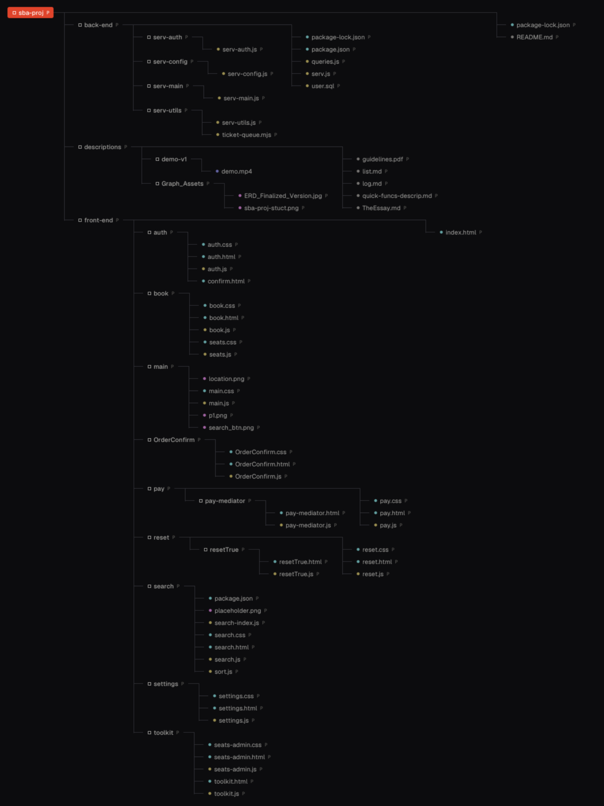
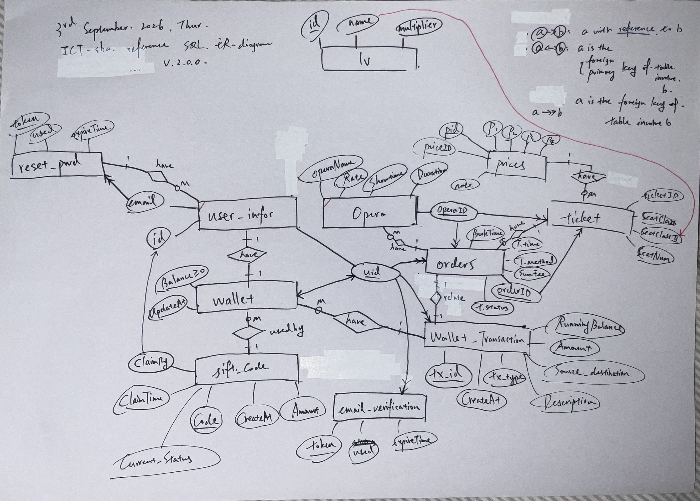
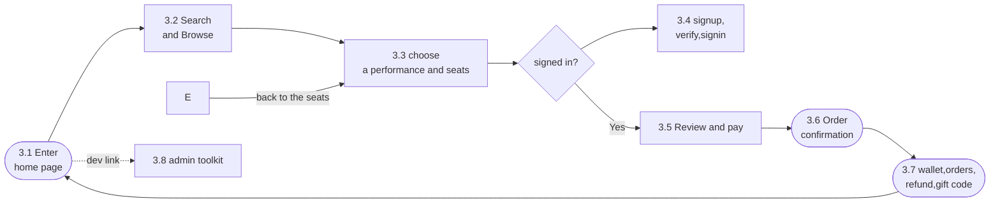
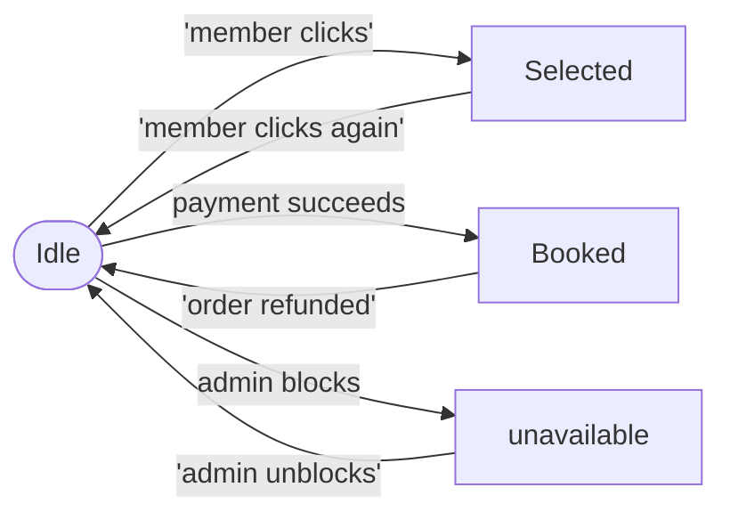

# ICT SBA Project, 2027 DSE,
## Clifford Wu Jia An, St Paul's College

## 1 intro.

### 1.1 overview
*This* project is an opera ticket booking system for the *option c booking-system* task following the sba guidelines.
A member can:
- search for an opera;
- choose his/her seats on a grid seat map;
- pay with a virtual wallet;
- refund the whole order on request  
An administrator can:  
- create gift codes;  
- monitoring and manage seat status;  
note that the payments are simulated. no real payment provider is provided,
so every payment is conducted by the member's wallet created automatically when they sign up a personal account.  
the database:(see `/back-end/user.sql`)
- holds 15 operaas with two performances each(30 performances in total)
- one seat map of 140 seats(row *a*-*j*, col *1*-*14*) shared by every performances.
  

### 1.2 main features
- sign up/sign in/reset password
- fuzzy search and filtering 
- select seat from a grid map and ticket types
- make payment
- refund
- admin tools  

---

## 2 database design

By using PostgreSQL,every requests goes through an *Express* server, which keeps all sql in one file (see backend/queries.js)

### 2.1 database ERD graph

| table(abbr)                   |primary key   |foreign key| constraints|use 
|:--:                           |:--:          |:--:                 |:--:|:--:|
| user_infor *(u)*              |u.uid         |-|-|store user-relate data|
|  wallet *(w)*                 |w.uid         | w.uid ref u.uid |balance>=0 |  store user balance|
|gift_code *(gc)*               |gc.code       | gc.cliam_by ref u.uid |- |gift code|
|email_verification *(ev)*      |ev.token      | ev.userid ref u.uid |- |signup token|
|pwd_reset *(pr)*               |pr.token      |  -  |- |reset token|
|opera *(op)*                   |op.opera_id   |  - |op.rate<=10.0 |opera data|
|prices *(p)*                   |p.pid         | p.opera_id ref op.opera_id| -|store prices|
|lv                             |lv.id         |  - |- |multipliers|
|orders *(or)*                  |or.order_id   | or.uid ref u.uid | -|store order details|
|seat *(s)*                     |s.seat_id     |  - | s.zone in designated value|seat data|
|seat_block *(sb)*              |sb.pid        | sb.pid ref p.pid sb.seat_id ref s.seat_id|-|blcoked seat&reason|
|ticket *(t)*                   |t.ticket_id   | t.opera_id ref u.uid t.order_id ref or.order_id t.pid ref p.pid t.seat_id ref s.seat_id;  |- |ticket data|
|wallet_transaction *(wt)*      |wt.tx_id      | wt.uid ref u.uid wt.order_id ref or.order_id |wt.amount>0 wt.tx_type in designated value | transac history|

#### 2.1.1 3nf design declaracion

- a price is stored once per performances in `prices` instead of repeatingly being stored in every ticket.
- a seat's row,col,num,zone are stored once in `seat`,the ticket only keeps the keys.
- `ticket.unit_price` is stored on purpose. It records what te member actually paid, thus a later change to `prices` cannot change old orders.
- a successful refund delete nothing. it sets `ticket.voided_at`. The history stays,and the seat counts as free again.

### 2.1.2 quick look up indexl

- the database itself refuses double booking.a unique index `ux_ticket_live_seat` means that two valid ticket for the same seat of the same performance cannot coexist,even if two requests were received at the same moment.

### 2.2 data structs

*Choosing* a data structure means asking three questions:
- what operation does the feature need;
- how often they are used;
- most resource-efficient structure that meets the requirements

each strcuture below is used somewhere in the project and is described in the same order:
- what is it;(a1)
- how i built and implemented it;(a2)
- where did i use it;(a3)
- why i chose it(a4)
#### 2.2.1 stack

##### 2.2.1.1 a1-stack
*A* **stack** is a lifo list(*last-in,first-out*): the item pushed last is popped first.

##### 2.2.1.2 a2-stack
i wrote my own `Stack` class in `sort.js`.It keeps its items in an array.
- a counter `top` that always points to the last item(-1 when the stack is empty).
- `push` increases `top` and stores the value,
- `pop` returns the item at `top` and decrease it
- `peek` reads it without removing it,
- `isEmpty` tests whether `top` is beloe zero(i.e.-1).
All four operations take a fix number of steps $O(1)$, because they only touch the end of the list.

##### 2.2.1.3 a3-stack
*The* stack is used by `quickSortInPlace`,Quick sort splits a list into smaller ranges and must come back to ranges that are not sorted yet.

##### 2.2.1.4 a4-stack
*Well* a common way to do this is recursion, but then the browser keeps a hidden call stack that is uncontrollable.  
Instead i push the range \[start,end] on my own stack,pop a range,split it, and push the two smaller ranges back.   
Pushing the larger range first means the smaller one is handled first,
so the stack never holds more than about $\log_2{(n)}$ ranges. 

The Advantage is that the memory use is visible and bounded,  
The Disadvantage is that the code is longer than the recursive version.  

#### 2.2.2 queue

##### 2.2.2.1 a1-queue
*A* **Queue** is a fifo list(*first-in,first-out*): The item that waited longest leaves first,like a real queue at a box office.

##### 2.2.2.2 a2-queue
My `Queue` class in `ticket-queue.mjs` has:  
`enqueue`(add at the back);  
`dequeue`(remove from the front);  
`isEmpty` and `length`.
Note that the queue does not store the items itself, it delegates to a linked list.

##### 2.2.2.3 a3-queue  
*The* queue is used in the payment route. After the order and the wallet payment are saved, the chosen seats are put in the queue in the order in which the memeber chose them.  
The route then repeatedly takes the first seat out, creates a ticket number for it and saves the ticket row. 
As a result, the ticket numbers and the `seat_num` column follow the order of selection,  and the confirmation page lists the tickets in the same order.
##### 2.2.2.4 a4-queue
*A* plain array would also work, but the queue states the tule ***First chosen,First ticketed*** in the code itself.

#### 2.2.3 linked list
##### 2.2.3.1 a1-linked list
*A* linked list stores each item in a node that also points to the next node, so items do not have to sit next to each other in memory.
##### 2.2.3.2 a2-linked list
*In* **JavaScript** i imitate pointers with array indices.  
`LinkedList` class in `ticket-queue.mjs` keeps:  
an array `nodes`;  
a `head`(index of the first node);  
a `tail`(index of the last node);  
a `length`;  
and a `next` index.  
To append, the list takes a free slot or the next new position, writes the node,links the old tail to it and moves `tail`.  
To remove the first item it reads the node at `head`, moves `head` to that node's `next`, and puts the slot in `freeSlots`.
##### 2.2.3.3 a3-linked list
*Adding* at the tail and removing from teh head both take $O(1)$ and never move the other items.With an ordinary array, `shift()` has to move every remaining item one place to the left, which is $O(n)$.
##### 2.2.3.4 a4-linked list
That diffrence is irrelevant for at most 8 tickets, but it is the reason a queue is normally built on a linked list,
and the same class would scale to a much larger queue.
The Price is a more complicated class and the need to manage `freeSlots` correctly.

#### 2.2.4 set
##### 2.2.4.1 a1-set
*A* set is a collection without duplicates that answers "is this item in the set" quickly.  
##### 2.2.4.2 a2-set
- see 2.2.4.3 a3-set.
##### 2.2.4.3 a3-set
The booking page keeps the chosen seats in a collection keyed by seat number(a`Map` from seat number to ticket type),
and the admin page keeps the picked seats in a `Set`.When a seat is clicked, the code asks whether the seat number is already there;
if it is, the seat is removed (a second click cancels the choice), otherwise it is added.  
The size of the collection gives the number of chosen seats, which is compared with the limit of 8, and the same collection supplies the list of seats that is sent to the server.
##### 2.2.4.4 a4-set
With an array the code would have to search the whole array on every click and prevent duplicates itself.  
A set makes duplicates impossible by design, and it also matches the rule on the server,which rejects an order that contains the same seat twice.

#### 2.2.5 map(hashmap)
##### 2.5.5.1 a1-map
*A* **hash table** stores items under a key and finds an item by its key in a fixed number of steps on average.
In JavaScript a plain object (or a `Map`) is a hash table.
##### 2.5.5.2 a2-map
The database returns one row for every performance, so an opera with two performances appears twice.  
The route creates an empty object `operaMap` and goes through the rows once.  
For each row it checks whether `operaMap\[opera_id]` exists;  
if not, it creates the entry(name,duration,rating and an empty list of plans,plus a search id made by lower_casing the name and replacing spaces with `-`);  
then it pushes the performance into that entry's `plans`.  
At the end `Object.values` turns the table into a list with one entry per opera.
##### 2.5.5.3 a3-map
It is used in the route `/updateOperaData`, which feeds the search page.  
##### 2.5.5.4 a4-map
Because each lookup takes one step, the whole job needs one pass over the rows,$O(n)$.  
Without the table the code would have to search the finished list for the opera for every row, which is $O(n^{2})$ in total.
The same idea is used on a smaller scale in `hall.prices\[seat.zone]` on the server,which finds a ticket-type multiplier from its name.

#### 2.2.6 two-dimensional grid
##### 2.2.6.1 a1-two-dimensional grid
basically 2d array.
##### 2.2.6.2 a2-two-dimensional grid
The database stores the seats as a flat list(`seat` table:row number, seat number,zone,wheelchair flag)
The browser turns that flat list into a grid by `groupByRow`(`seat.js`):a `Map` whose key is the row letter(`A`to `J`)
and whose value is an array of the seats of that row,sorted by seat number.
The result is a grid of 10 rows by 14seats.`renderSeatGrid` then walks through the grid row by row; for every row it creates a line, writes the row letter and adds one button per seat.
##### 2.2.6.3 a3-two-dimensional grid
*A* theatre hall is naturally two-dimensional,rows and seats in a row. 
##### 2.2.6.4 a4-two-dimensional grid
*Keeping* the seats in a flat list in the database is better for storage and queries,(every seat is one row with a key), while the grid is better for drawing.Building the grid in the browser, once per page load, gives both.
The same function draws the booking page and the administrator page, so a change in the layout appears in both.
The cost is one extra pass over 140 seats, which is negligible.

#### 2.2.7 Sorted array
##### 2.2.7.1 a1-sorted array
*Binary* search is only correct if the data are sorted, 
##### 2.2.7.2 a2-sorted array
- see 2.2.7.3
##### 2.2.7.3 a3-sorted array
`OperaSearchIndex` in `search-index.js` keeps two copies of the opera list;  
`items` in the original order and `sorted`, ordered by lower-cased name.   
The sorted copy is built once when the page loads,using the quick sort(will be discussed later),
and the search page then uses it to find an exact name by binary search(will be discussed later),
With 15 operas the diffrence to a linear scan is tiny,but binary search needs at most about $\log_2{(n)}$ steps(4 steps for 15 items,20 steps for a mil).
##### 2.2.7.4 a4-sorted array
Keeping two arrays costs a little more memory and means the index must be rebuilt(`replace`) whenever the opera list changes.I accepted that because the opera list is loaded only once per page.The unsorted copy is still needed: the "name contains the text" search uses a linear search through `items`,and the original order is the tie-breaker when two operas get the same raking score.

#### 2.2.8 records,strings and arrays
##### 2.2.8.1 a1-rsa
most data in the program are records, one thing with several named fields.
An opera in the browser is an object`{id,name,rate,duration,plans}`, where `plans` is an array of performances`{price_id,budget,time}`. 
A seat is `{}`
##### 2.2.8.2 a2-rsa
##### 2.2.8.3 a3-rsa
##### 2.2.8.4 a4-rsa

---

## 3. features
*The* features are described in the order which a member really meets them.  
A visit starts on the homw page, goes through search,choosing seats,signing in (the system requests for it only at the moment of ordering),review,payment and confirmation, and ends with the after-sales pages(wallet,refund).  
The admin tools sit beside this path.  
The home page `index.html` is the main manu, every feature starts from it and returns to it, so each visit to the home page is the start of the 'menu loop'

*Figure 2*, user's journey. The arrow from 3.4 to 3.3 shows that after signing in , the user returns to the seat page with the chosen seats restored.

### 3.1 Home
Give every visitor,regardless the signin status, one place from which all other features are reachable.

1. the home page shows 
- the search box
- a *Sign in/up* link 
- a link to dev page
2. on load, the page reads `isLoggedIn` and `user` from ***Localstorage***. If user is already signed in, the authentication link changes to the user's account setting spage(3.7) and a *log out* link appears; otherwise it points to the sign-in page(3.4)
3. Typing a word in the search box and pressing the btn stores the word in ***localstorage***(`search_content`) and opens the search page(3.2), which it reads it and run the search at once.
4. *Log out* removes `isLoggedIn` and `user` from ***localstorage*** and reloads the home page.
5. the dev link asks for a password in a browser prompt(pwd:aaaa) before it opens the admin tool(3.8)

|page|data used|
|:--:|:--:|
|`index.html`,`main/main.js`|`localstorage`:`isLoggedIn`,`user`,`search_content`|
### 3.2 search/browse
Help a user find an opera quickly.

1. The search page asks the server for all operas and their performances(`post /updateOperaData`,hash table 2.2.4)
2. if the search box is empty, every opera is shown. otherwise each opera gets a score: **-2** if the name matches exactly as the text, **-1** if the name contains the text, otherwise the **Levinshtein distance** between the text and the name. thee results are ordered by score; equal scores keep the original order(4.2.1)
3. the user may choose one of five sort orders. each uses a different algorithm(chap.4)
4. 3 operas are shown per page. "previous" on the first page and "next" on the last page are disabled.
5. each opera shows its name, budget price(min price), rating,duration and show time. the show time is a drop-down list of the performances; choosing another performance changes the shown time and price.
6. clicking the opera name stores the chosen opera performance and time in `localstorage` and operns the booking page.

|sort option|algorithm|
|:--:|:--:|
|name |merge sort|
|show time| insertion sort|
|price(high to low)|bubble sort|
|rating(high to low)|bubble sort|
|duration|selection sort|

|page|route|table|
|:--:|:--:|:--:|
|`search.html`,`search.js`,`sort.js`,`search-index.js`|`post /updateOperaData`|`opera`,`prices`|
### 3.3choose seats
book/seat,post seatmap
The seat map has 140 seats in ten rows (A–J). A seat can be idle, selected, booked or unavailable; booked and unavailable seats cannot be clicked.

The user picks real seat instead of just a quantity

1. The booking page reads the chosen opera and performnace from `localStorage` and asks the server for the seat map of that performance (`POST /seatMap): all 140 seats with their zone, the seats already booked, the seats made unavailable, the four zone prices and the ticket-type multipliers.

2. Each seat is a button in one of four states, idle, selected, booked (a valid ticket exists) or unavailable(the admin blocked it). Booked and unavailable seats cannot be clicked. wheelchair spaces are marked.

3. clicking an idle seat selects it; clicking it again cancels the choice.for every selected seat the member chooses a ticket type;adult,student or wheelchair;the wheelchair type is only offered for a wheelchiar space.

4. the price of each seat and the total are shown immediately; zone price * ticket-type multiplier,rounded to cents. the user can also refresh the seat map to see seats that were booked meanwhile.

5. at most 8 seats can be selected; the 9th click shows a message.

6. When the member presses Confirm, the page checks that at least one seat is chosen, then checks whether the member is signed.

If not, the apge saves the chosen seats and the address of the seat page in `localstorage` and opens the sign-in page; after signing in the user comes back and the seats are restored. 
if the user is signed in, the chosen seats, the prices and the total are saved in `localstorage`(`details`) and the review page opens

*Fig.3* seat states. note that the admin cannot block a booked seat

|page||route|table|
|:--:|:--:|:--:|
|`book.html`,`book.js`,`seats.js`|`POST /seatMap`|`seat`,`ticket`,`seat_block`,`prices`,`lv`|

### 3.4 authentication

Only verifies users may spend money and passwords must never be stored in plain text.

A visitor may search and choose seats freely and is only sent to the sign-in page when pressing *Confirm* without being signed in.

1. **Sign up** The password must meet all the requirements below:
- range between 8-64 characters 
- at least one uppercase letter
- at least one lowercase letter
- at least one digit
- at least one special letter
Every broken rule is reported. 
The user name must not exist yet.
The server creates a random salt,hashes the password with the salt by using `scrypt` and saves the account as not verified.

2. **Verify** A verificatoni email contains a link with a random token valid for one day and usable once. opening the link marks the account verified,marks the token used and creates the user's wallet with initial balance $0.00.

3. **Sign in** The server compares the hash of the typed password with the stored hash. An account ths

### 3.5 Wallet, refund
settings:POST /settingGetData、/settingsGetOrders、/refundOrder、/redeem；
sql: wallet、wallet_transaction、orders、ticket、gift_code
### 3.6 admin.tools

front-end: toolkit/seats-admin

back-end: /toolkit/gen_redeem_code、/toolkit/sessions、/toolkit/seat_status、/toolkit/seat_block。

---

## 4 algos and flowcharts

### 4.1 sort

|search|best case|worst case|average|stability|space extra|
|:--:|:--:|:--:|:--:|:--:|:--:|
|selection| $O(n^{2})$ | $O(n^{2})$|$O(n^{2})$|no|$O(1)$|
|insertion| $O(n)$       |$O(n^2)$|$O(n^2)$|yes|$O(1)$|
|merge|     $O(n \log{n})$|$O(n\log{n})$|$O(n\log{n})$|yes|$O(n)$|
|quick|     $O(n \log{n})$   |$O(n^{2})$(rare)|$O(n\log{n})$|no|$O(\log{n})-O(n)$ (stack)|
|bubble|    $O(n)$       |$O(n^2)$|$O(n^2)$|yes|$O(1)$
#### 4.1.1 selection sort

#### 4.1.2 insertion sort

#### 4.1.3 merge sort

#### 4.1.4 quick sort

#### 4.1.5 bubble sort

### 4.2 others

#### 4.2.1 fuzzy search-levenshtein distance
example reference table required
o-notation

#### 4.2.2 linear search&binary search
search-index.js binarySearch、linearSearch、findExact、findPartial

m
#### 4.2.3 sum price and unit price calculation

`seatUnitPrice`
per*multiplier
---

## 5 implementation

### 5.1 implementation-seat

### 5.2 implementation-seat-price

### 5.3 implementation-search

### 5.4 implementation-search-II-sort

### 5.5 implementation-transac

### 5.6 implementation-admin/seat-stat

### 5.8 implementation-auth/validate

---
## 6 boundary case,test,error track

---

## 7 .test/user feedback(?)

---

## 8 improvement and eval

---

with reference to:

inspiration and ui/ux design:
https://urbtix.hk

font used:
https://fonts.google.com/

mailersend api
https://www.mailersend.com

