# ICT SBA Project, 2027 DSE,
## Clifford Wu Jia An, St Paul's College


## 1 Intro.

### 1.1 Overview
This project is an opera ticket booking system for the *option C booking-system* task following the sba guidelines.  

A user can:
- search for an opera;
- choose his/her seats on a grid seat map;
- pay with a virtual wallet;
- refund the whole order on request  

An administrator can:  
- create gift codes;  
- monitoring and manage seat status;  

Note that the payments are simulated, no real payment provider is provided, 

Thus every payment is conducted by the user's wallet created automatically when they sign up a personal account.


The database:(with reference to `/back-end/user.sql`)
- holds 15 operas with two performances each (30 performances in total)
- one seat map of 140 seats(**row** *a*-*j*, **col** *1*-*14*) shared by every performances.
  

### 1.2 Main features overview
- sign up/sign in/reset password
- fuzzy search and filtering 
- select seat from a grid map and ticket types
- make payment
- refund
- admin tools  


---


## 2 Database design

Powered by PostgreSQL,every requests goes through an *Express* server, which keeps all query sentence in one file (with reference to `backend/queries.js`)

### 2.1 Database ERD graph


| Table(abbr)                   |Primary key   |Foreign key| Constraints|Use 
|:--:                           |:--:          |:--:                 |:--:|:--:|
| user_infor *(u)*              |u.uid         |-|-| user data|
|  wallet *(w)*                 |w.uid         | w.uid *ref* u.uid |balance>=0 |  user balance|
|gift_code *(gc)*               |gc.code       | gc.claim_by *ref* u.uid |- |gift code|
|email_verification *(ev)*      |ev.token      | ev.userid *ref* u.uid |- |signup token|
|pwd_reset *(pr)*               |pr.token      |  -  |- |reset token|
|opera *(op)*                   |op.opera_id   |  - |op.rate<=10.0 |opera data|
|prices *(p)*                   |p.pid         | p.opera_id *ref* op.opera_id| -|store prices|
|lv                             |lv.id         |  - |- |multipliers|
|orders *(or)*                  |or.order_id   | or.uid *ref* u.uid | -|store order details|
|seat *(s)*                     |s.seat_id     |  - | s.zone in designated value|seat data|
|seat_block *(sb)*              |sb.pid        | sb.pid *ref* p.pid<br>sb.seat_id *ref* s.seat_id|-|blocked seat&reason|
|ticket *(t)*                   |t.ticket_id   | t.opera_id *ref* u.uid<br>t.order_id *ref* or.order_id<br>t.pid *ref* p.pid<br>t.seat_id *ref* s.seat_id;  |- |ticket data|
|wallet_transaction *(wt)*      |wt.tx_id      | wt.uid *ref* u.uid<br>wt.order_id *ref* or.order_id |wt.amount>0<br>wt.tx_type in designated value | transac history|


#### 2.1.1 3nf design declaration

- a price is stored once per performances in `prices` instead of repeatingly being stored in every ticket.
- a seat's row,col,num,zone are stored once in `seat`,the ticket only keeps the keys.
- `ticket.unit_price` is stored on purpose. It records what the user actually paid, thus a later change to `prices` cannot change old orders.All tickets should be recorded at their selling price as this is the exact amount the playform earned from the user at the moment of purchasing.
- a successful refund delete nothing. it sets `ticket.voided_at`. The payment history stays in the database,and the seat counts as free again.

### 2.1.2 Quick look up index

- the database itself refuses double booking. A unique index `ux_ticket_live_seat` means that two valid tickets for the same seat of the same performance cannot coexist,even if two requests were received at the same moment.

### 2.2 Data structures

Choosing a data structure means asking three questions:
- What operation does the feature need;
- How often they are used;
- Most resource-efficient structure that meets the requirements.

Each structure below is used somewhere in the project and is described in the same order:
- What is it; **(a1)**
- How i built and implemented it; **(a2)**
- Where did i use it; **(a3)**
- Why i chose it; **(a4)**
#### 2.2.1 Stack
##### 2.2.1.1 a1-stack
A **stack** is a lifo list (*last-in,first-out*): the item pushed last is popped first.

##### 2.2.1.2 a2-stack
As there does not exist a build-in `stack` data structure in *JavaScript*, I wrote my own `Stack` class in `sort.js`. It keeps its items in an array.
- a counter `top` that always points to the last item(-1 when the stack is empty).
- `push` increases `top` and stores the value,
- `pop` returns the item at `top` and decrease it
- `peek` reads it without removing it,
- `isEmpty` tests whether `top` is below zero($i.e. -1$).
All four operations take a fix number of steps $O(1)$, because they only touch the end of the list.


##### 2.2.1.3 a3-stack
The stack is used by `quickSortInPlace`, Quick sort splits a list into smaller ranges and must come back to ranges that are not sorted yet.

##### 2.2.1.4 a4-stack
A common way to do this is recursion, but then the browser keeps a hidden call stack that is uncontrollable.  
As a alternative solution, I choose to:
- **push the range** [start,end] on my own stack
- **pop a range**
- **split it**
- **push the two smaller ranges back**.   

Pushing the larger range first means the smaller one is handled first,
so the stack never holds more than about $\log_2{(n)}$ ranges. 

- The Advantage is that the memory use is visible and bounded,  
- The Disadvantage is that the code is longer than the recursive version.  

#### 2.2.2 Queue

##### 2.2.2.1 a1-queue
A **Queue** is a fifo list (*first-in,first-out*):  
The item that waited longest leaves first,like a real queue at a box office.

##### 2.2.2.2 a2-queue
My **Queue** class in `ticket-queue.mjs` has:  
`enqueue` (add at the back);  
`dequeue` (remove from the front);  
`isEmpty` and `length`.  
Note that the queue does not store the items itself, it delegates to a linked list.

##### 2.2.2.3 a3-queue  
The queue is used in the payment route.  
After the order and the wallet payment are saved, the chosen seats are put in the queue in the order in which the user chose them.  
The route then repeatedly takes the first seat out, creates a ticket number for it and saves the ticket row.   
As a result, the ticket numbers and the `seat_num` column follow the order of selection,  and the confirmation page lists the tickets in the same order.
##### 2.2.2.4 a4-queue
A plain array would also work, but the queue states the rule ***First chosen,First ticketed*** in the code itself.


#### 2.2.3 Linked list
##### 2.2.3.1 a1-linked list
A linked list stores each item in a node that also points to the next node, so items do not have to sit next to each other in memory.
##### 2.2.3.2 a2-linked list
In **JavaScript** i imitate pointers with array indices.  
`LinkedList` class in `ticket-queue.mjs` keeps:  
an array `nodes`;  
a `head` (index of the first node);  
a `tail` (index of the last node);  
a `length`;  
and a `next` index.  
To append, the list takes a free slot or the next new position, writes the node,links the old tail to it and moves `tail`.  
To remove the first item it reads the node at `head`, moves `head` to that node's `next`, and puts the slot in `freeSlots`.
##### 2.2.3.3 a3-linked list
Adding at the tail and removing from the head both take $O(1)$ and never move the other items.  
With an ordinary array, `shift()` has to move every remaining item one place to the left, which is $O(n)$.
##### 2.2.3.4 a4-linked list
That difference is irrelevant for at most 8 tickets, but it is the reason a queue is normally built on a linked list,
and the same class would scale to a much larger queue.
The Price is a more complicated class and the need to manage `freeSlots` correctly.


#### 2.2.4 set
##### 2.2.4.1 a1-set
*A* set is a collection without duplicates that answers "is this item in the set" quickly.  
##### 2.2.4.2 a2-set
- see [2.2.4.3 a3-set](#2243-a3-set)
##### 2.2.4.3 a3-set
The booking page keeps the chosen seats in a collection keyed by seat number(a`Map` from seat number to ticket type), and the admin page keeps the picked seats in a `Set`.When a seat is clicked, the code asks whether the seat number is already there;
if it is, the seat is removed (a second click cancels the choice), otherwise it is added.  
The size of the collection gives the number of chosen seats, which is compared with the limit of 8, and the same collection supplies the list of seats that is sent to the server.
##### 2.2.4.4 a4-set
With an array the code would have to search the whole array on every click and prevent duplicates itself.  
A set makes duplicates impossible by design, and it also matches the rule on the server,which rejects an order that contains the same seat twice.


#### 2.2.5 map(hashmap)
##### 2.5.5.1 a1-map
A **hash table** stores items under a key and finds an item by its key in a fixed number of steps on average.
In *JavaScript* a plain object (or a `Map`) is a hash table.
##### 2.5.5.2 a2-map
The database returns one row for every performance, so an opera with two performances appears twice.  
The route creates an empty object `operaMap` and goes through the rows once.  
For each row it checks whether `operaMap[opera_id]` exists;  
If not, it creates the entry with following data:
- **name**
- **duration** 
- **rating**
- **an empty list of plans**
- **a search id** made by lower_casing the `name` and replacing `spaces` with `-`;  

It pushes the performance into that entry's `plans`.  
At the end, `Object.values` turns the *table* into a *list* with one entry per opera.
##### 2.5.5.3 a3-map
It is used in the route `/updateOperaData`, which feeds the search page.  
##### 2.5.5.4 a4-map
Because each lookup takes one step, the whole job needs one pass over the rows, $O(n)$.  
Without the table the code would have to search the finished list for the opera for every row, which is $O(n^{2})$ in total.
The same idea is used on a smaller scale in `hall.prices[seat.zone]` on the server, which finds a ticket-type multiplier from its name.

#### 2.2.6 Two-dimensional grid
##### 2.2.6.1 a1-two-dimensional grid
Basically 2d array.
##### 2.2.6.2 a2-two-dimensional grid
The database stores the seats as a flat list (`seat` table: **row number**, **seat number**,**zone**,**wheelchair flag**)

The browser turns that flat list into a grid by `groupByRow` (`seat.js`):  
a `Map` whose key is the row letter(`A`to `J`) and whose value is an array of the seats of that row, sorted by seat number.
The result is a grid of 10 rows by 14 seats each. `renderSeatGrid` then walks through the grid row by row; for every row it creates a line, writes the row letter and adds one button per seat.
##### 2.2.6.3 a3-two-dimensional grid
A theatre hall is naturally two-dimensional, rows and seats in a row. 
##### 2.2.6.4 a4-two-dimensional grid
Keeping the seats in a flat list in the database is better for storage and queries, where every seat is one row with a key.  
While the grid is better for drawing and building the grid in the browser, once per page load, gives both.  
The same function draws the booking page and the administrator page, so a change in the layout appears in both.
The cost is one extra pass over 140 seats, which is negligible.


#### 2.2.7 Sorted array
##### 2.2.7.1 a1-sorted array
Prerequisite condition: Binary search is only correct if the data are sorted, 
##### 2.2.7.2 a2-sorted array
- see [section 2.2.7.3](#2273-a3-sorted-array)
##### 2.2.7.3 a3-sorted array
`OperaSearchIndex` in `search-index.js` keeps two copies of the opera list;  
`items` in the original order and `sorted`, ordered by lower-cased name.   
The sorted copy is built once when the page loads, using the **quick sort** (will be discussed later),  
and the search page then uses it to find an exact name by **binary search** (will be discussed later),  
With 15 operas the difference to a linear scan is tiny,but binary search needs at most about $\log_2{(n)}$ steps (4 steps for 15 items,20 steps for 1 million items).
##### 2.2.7.4 a4-sorted array
Keeping two arrays costs a little more memory and means the index must be rebuilt (`replace`) whenever the opera list changes.  
I accepted that because the opera list is loaded only once per page. The unsorted copy is still needed: the **name contains the text** search uses a linear search through `items`, and the original order is the tie-breaker when two operas get the same ranking score.


#### 2.2.8 records,strings and arrays

Most data in the program are records, one thing with several named fields:  
- An opera in the browser is an object`{ id, name, rate, duration, plans }`,
  - where `plans` is an array of performances`{ price_id, budget, time }`;  
- A seat is `{ seat_id, row, col, zone, accessible, state }`;
- A ticket is `{ticketId, level,seatClass2, seat, unitPrice}`;  
And the booking details stored in `localStorage` between pages are **one record that contains an array of seat records**.

On the server the same shapes are filled from database rows, using one record for one thing keeps related values together, so a function receives one argument instead of six, and the field names make the code readable

Strings carry names, labels such as `A1`, and search text.  
They are compared only after standardized processing (`trim()` and `toLowerCase()`).  
Thus `aida`, `Aida` and `AIDA` are the same opera.  

Plain one-dimensional arrays hold lists of fixed kind:
- 5 zone names (`ZONES`);
- 3 ticket types (`AUDIENCES`);
- 30 performances of an opera list.

Constraints such as `MAX_SEATS = 8` give a limit one name that every check uses, so it can be changed in a single place.


---

## 3. Features
### 3.0 Features-overview
The features are described in the order which a user really meets them.  
A visit starts on the home page, goes through search,choosing seats,signing in (the system requests for it only at the moment of ordering),review,payment and confirmation, and ends with the after-sales pages(wallet,refund).  
The admin tools sit beside this path.  
The home page `index.html` is the main menu, every feature starts from it and returns to it, so each visit to the home page is the start of the 'menu loop'


*Fig 2*, user's journey.  
The arrow from 3.4 to 3.3 shows that after signing in , the user returns to the seat page with the chosen seats restored.

### 3.1 Home
Give every visitor,regardless the signin status, one place from which all other features are reachable.

1. The home page shows 
- the search box
- a *Sign in/up* link 
- a link to dev page
2. On load, the page reads `isLoggedIn` and `user` from ***Localstorage***.  
If user is already signed in, the authentication link changes to the user's account setting spage ([section 3.7](#37-settings)) and a *log out* link appears; otherwise it points to the sign-in page ([section 3.4](#34-authentication))
3. Typing a word in the search box and pressing the btn stores the word in ***localstorage*** (`search_content`) and opens the search page ([section 3.2](#32-searchbrowse)), which it reads it and run the search at once.
4. *Log out* removes `isLoggedIn` and `user` from ***localstorage*** and reloads the home page.
5. The dev link asks for a password in a browser prompt (pwd:aaaa) before it opens the admin tool ([section 3.8](#38-admin-tools))


|page|data used|
|:--:|:--:|
|`index.html`,`main/main.js`|**localstorage**:`isLoggedIn`,`user`,`search_content`|


### 3.2 Search/Browse
Help a user find an opera quickly.

1. The search page asks the server for all operas and their performances (`post /updateOperaData`,hash table([section 2.2.4](#224-set)))
2. If the search box is empty, every opera is shown. otherwise each opera gets a score:  
- $-2$ if the name matches exactly as the text,  
- $-1$ if the name contains the text,  
- otherwise the **Levenshtein distance** between the text and the name. the results are ordered by score; equal scores keep the original order([section 4.2.1](#421-fuzzy-search-levenshtein-distance))
3. The user may choose one of five sort orders. each uses a different algorithm([chap.4](#4-algos-and-flowcharts))
4. $3$ operas are shown per page. **previous** on the first page and **next** on the last page are disabled.
5. Each opera shows its:
- name 
- budget price (minimum price) 
- rating
- duration 
- show time  
The show time is a **drop-down list** of the performances,  
Choosing another performance changes the shown time and price.
6. Clicking the opera name stores the chosen opera performance and time in `localstorage` and opens the booking page.

|Sort option|Algorithm|
|:--:|:--:|
|Name |Merge sort|
|Show time| Insertion sort|
|Price (high to low)|Bubble sort|
|Rating (high to low)|Bubble sort|
|Duration|Selection sort|

|page|route|table|
|:--:|:--:|:--:|
|`search.html`,`search.js`,`sort.js`,`search-index.js`|`post /updateOperaData`|`opera`,`prices`|

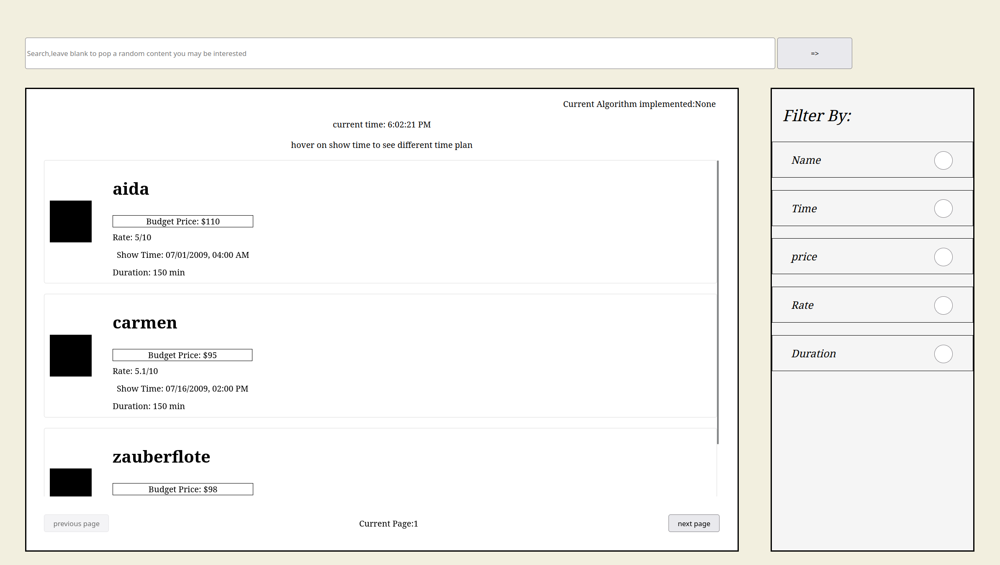

### 3.3 Choose seats

The seat map has 140 seats in 10 rows (A–J)  
A seat can be idle, selected, booked or unavailable  
Booked and unavailable seats cannot be clicked

The user can pick real seats instead of quantities.

1. The booking page reads the chosen opera and performance from `localStorage` and asks the server for the seat map of that performance (`POST /seatMap`): all 140 seats with their zone, the seats already booked, the seats made unavailable, the four zone prices and the ticket-type multipliers.

2. Each seat is a button in one of four states, idle, selected, booked (a valid ticket exists) or unavailable(the admin blocked it). Booked and unavailable seats cannot be clicked. wheelchair spaces are marked.

3. clicking an idle seat selects it; clicking it again cancels the choice.for every selected seat the user chooses a ticket type;adult,student or wheelchair;the wheelchair type is only offered for a wheelchair space.

4. the price of each seat and the total are shown immediately; zone price * ticket-type multiplier,rounded to cents. the user can also refresh the seat map to see seats that were booked meanwhile.

5. at most 8 seats can be selected; the 9th click shows a message.

6. When the user presses Confirm, the page checks that at least one seat is chosen, then checks whether the user is signed.

If not, the page saves the chosen seats and the address of the seat page in `localstorage` and opens the sign-in page; after signing in the user comes back and the seats are restored.  
If the user is signed in, the chosen seats, the prices and the total are saved in `localstorage`(`details`) and the review page opens

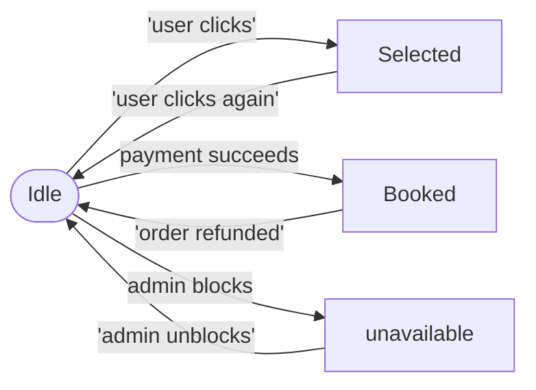

*Fig.3* seat states. note that the admin cannot block a booked seat

|page|route|table|
|:--:|:--:|:--:|
|`book.html`,`book.js`,`seats.js`|`POST /seatMap`|`seat`,`ticket`,`seat_block`,`prices`,`lv`|

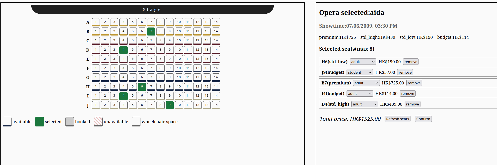
### 3.4 Authentication

Only verifies users may spend money and passwords must never be stored in plain text.

A visitor may search and choose seats freely and is only sent to the sign-in page when pressing *Confirm* without being signed in.

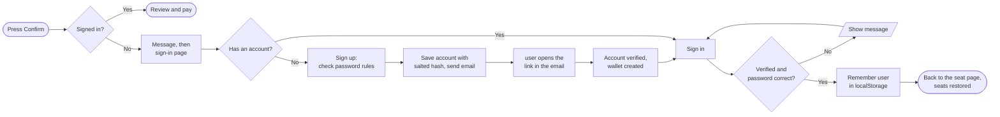

*Fig 4. Authentication path.*


1. **Sign up**  
The signup materials must meet all the requirements below:
- The user name must not exist yet.
- pwd: range between 8-64 characters 
- pwd: at least one uppercase letter
- pwd: at least one lowercase letter
- pwd: at least one digit
- pwd: at least one special character

Note that Every broken rule is reported. 

The server creates a random salt,hashes the password with the salt by using `scrypt` and saves the account as not verified.

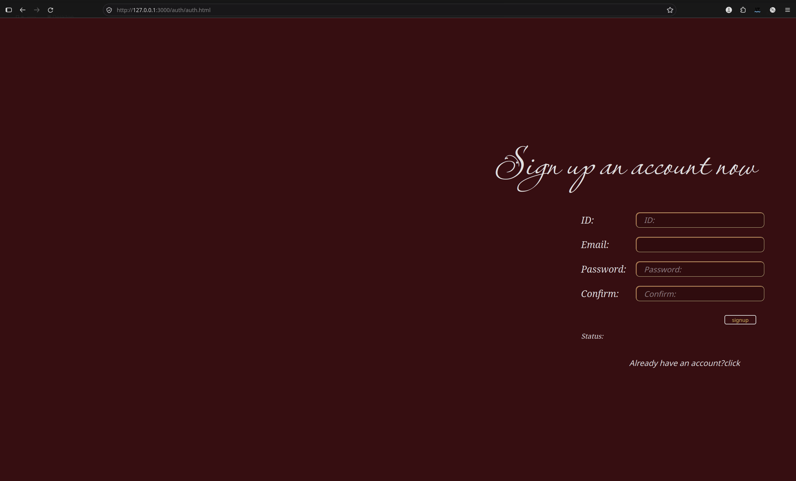

2. **Verify**  
A verification email contains a link with a random token valid for one day and usable once. opening the link marks the account verified,marks the token used and creates the user's wallet with initial balance $0.00.
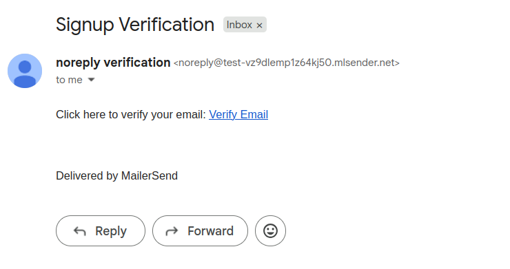

3. **Sign in**  
The server compares the hash of the typed password with the stored hash.An account that is not verified is refused. On success the browser stores `isLoggedIn` and `user` in `localStorage` and returns to the home page.

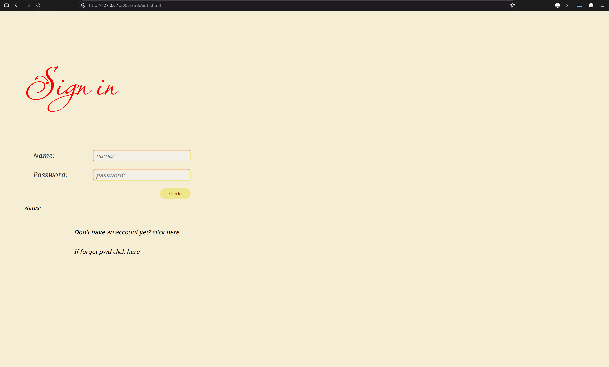

4. **Forgotten password**  
The user enters the email address; a reset link with a token valid for 15 minutes is emailed.The new password is checked against the same rules, saved with a new salt, and the token is marked used. A signed-in user reaches the same page from the account page([settings,section 3.7](#37-settings))
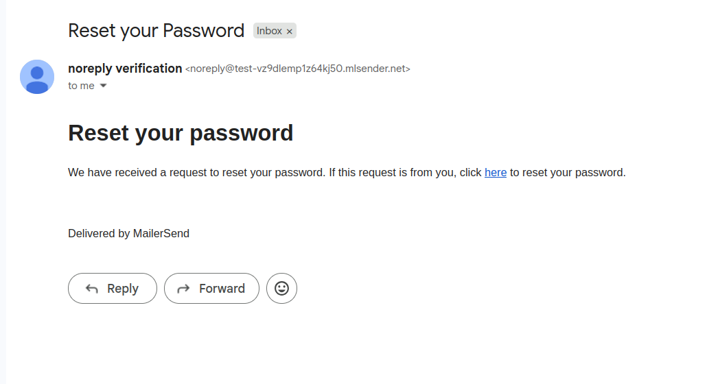


**Return to the seats**  
Before opening the sign-in page, the seat page stores `returnTo` (the seat page) and `pendingSeats` (the chosen seats and ticket types). After a successful sign-in,the browser goes back to the seat page only if `returnTo` is exactly the seat page (a fixed list of allowed addresses,so the value cannot send the user somewhere else); otherwise it goes to the home page.The seat page puts the stored seats back, and the normal reload of the seat map removes any seat that was booked or blocked in the meantime.

***Limit*** After sign-in the browser only remembers the user name;the server does not issue a login credential ([chap.6, boundary-error-track](#6-boundary-casetesterror-track))

|page|route|table|
|:--:|:--:|:--:|
|`auth.html`<br/>`auth.js`<br/> `confirm.html`|`POST /auth/signup`<br/>`GET /auth/:token`<br/>`POST /auth/login`|`user_infor`<br/>`email_verification`<br/>`wallet`|
|`reset.html`|`POST /reset`<br/>`GET /reset/:token`<br/>`POST /reset/updatepwd`|`pwd_reset`<br/>`user_infor`|
### 3.5 Payment and transaction

Show the user exactly what will be bought, then turn the selected seats into tickets without ever charging for tickets that do not exist.

1. **Review page** (`pay.html`)  
It lists the opera,the show time, every seat with its zone, ticket type and price, and the total price.
*Return* goes back to the booking page;
*Continue* opens the processing page.
If the booking details arer missing,the user is sent back to the booking page.

2. **Processing page** (`pay-mediator`)
It shows a rotating "please wait" message and sends the order to the server (`POST /PaymentOrder`):`username`, `opera` ,`performance` and the chosen `seats` with their `ticket types`.
**The total from the browser is not sent as a price to trust.**

3. **The server side** runs the steps of *fig.5* in one database transaction.
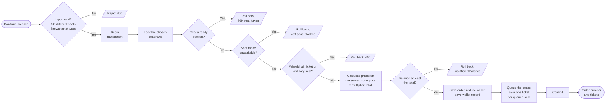
*Fig.5* Payment Flowchart, every rejected branch ends before any money is taken.


4. **response the processing page**
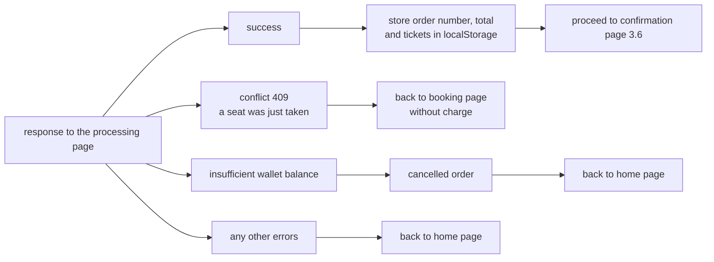
*Fig.6* response to the processing page

|page|route|table|
|:--:|:--:|:--:|
|`pay.html,.js`<br/>`pay-mediator.html,.js`|`POST /PaymentOrder`|`seat`<br/>`ticket`<br/>`prices`<br/>`lv`<br/>`wallet`<br/>`orders`<br/>`wallet_transaction`|


### 3.6 Order confirmation


Give the user proof of the purchase.

1. The page reads :
- **order number** 
- **total price** 
- **ticket** 
from **localStorage** and shows:
- **order number** 
- **user** 
- **opera**
- **show time** 
- **ticket level**
- **the number of adult/student/wheelchair tickets**
- **the total price paid** 
and one line per ticket:
- **ticket number**
- **seat**
- **zone**
- **ticket type**

2. The user can press *send me a copy* to receive the confirmation email (`POST /sendConfirmationEmail`).
The page reports success or failure of the sending: a failure does not affect the order.

3. *Return to home* goes back to the home page, from which the account page is reached.

|Page|Route|
|:--:|:--:|
|`OrderConfirm.html,.js`|`POST /SendConfirmationEmail`|


### 3.7 Settings

Allow a user to see the balance and orders, refund an order and add balance by using a gift code.

1. **Account page** (`settings.html`)  
It shows:  
- user's `username`,`email`.`birth`,`signup date` and `wallet balance` (`POST /settingGetData`)   
- A list of all orders with `date`,`opera`,`ticket breakdown`, `amount` and `status` (`POST /settingsGetOrders`)

2. **Refund** each completed order has a *Refund* button: a refunded order shows its status and the button is disabled. The server refunds the **WHOLE ORDER** (ref. to Fig.6)
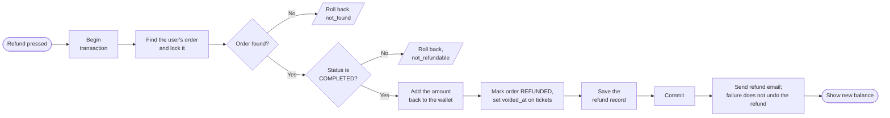

*Fig 6*. Refund flowchart. After the refund the seats are idle again (Fig.3).

3. **Gift code**  
The user types a code a presses *Redeem* (`POST /redeem`).  
The code row is locked, the two members cannot redeem the same code at once, an unknown code gives *invalid*,a used code gives *already redeemed*;otherwise the amount is added to the wallet and the code is marked as used with the user and the time.

4. **Change password**  
The *reset* button nex the the password opens the password reset page(3.4)

5. **Change email and birth date**  
The **update** button next to each opens an input box. the server checks the new value before saving it. 

- An email address must pass the regex validation check: must contain `@` and a dot and have at most 50 characters.
- A birth date must have the form `YYYY-MM-DD`, be a real date (so 30 feb is refused), not be in the future. 
- A wrong value shows the message and changes nothing.
- A valid value is saved and shown at once(`POST /updateEmail`).  the email address is not verified again after a change([section6.2](#62-constraints-and-limitations))


| Page | Route | Table |
| :--: | :--: | :--: |
| `settings.html,.js` | `POST /settingGetData`<br/>`/settingsGetOrders`<br/>`/refundOrder`<br/>`/redeem`<br/>`/updateEmail`<br/>`/updateBirth` | `user_infor`<br/>`wallet`<br/>`orders`<br/>`ticket`<br/>`wallet_transaction`<br/>`gift_code` |


### 3.8 Admin tools

Allow the administrator create gift codes ,manage and control seats. these tools are beside the normal user's journey, reached from the dev link on the home page, 

1. **Access**  
The dev link asks for a password in a browser prompt; a wrong password shows a refuse message.

2. **Gift Codes** the admin enters a positive amount.
The pages creates a random code in the form of `XXXX-XXXX-XXXX`(digits and capital letters) and sends it to the server (`POST /toolkit/gen_redeem_code`),which saves it.
the code is shown so that it can be copied and given to a user.

3. **Seat monitor**
The admin chooses a performance (`POST /toolkit/sessions`) and sees the seat map with the state of every seat, summary cards(seats,idle,booked,unavailable,status,income,refunded tickets) and a table by zone (`POST /toolkit/seat_status`)
a filter dims the seats that are not in ticket type, the price paid and the time. 
the page automatically refreshes itself every 5 seconds.

4.  **Status of the seat**
The admin selects several seats, optionally enters a reason, and press the button (`POST /toolkit/seat_block`). a seat that is already booked cannot be blocked(status 409),and blocked seats cannot be bought by users (3.3,3.5)

***Limitations***
- The password prompt to enter the dev page only stops a casual visitor
- The `/toolkit/...` routes have no check on the server , so anyone who know the address can call them. 


| Page | Route | Table |
| --- | --- | --- |
| `toolkit.html,.js`<br/>`seats-admin.html,.js` | `POST /toolkit/gen_redeem_code`<br/>`/toolkit/sessions`<br/>`/toolkit/seat_status`<br/>`/toolkit/seat_block` | `gift_code`<br/>`prices`<br/>`seat`<br/> `ticket`<br/>`seat_block`<br/>`orders`<br/>`user_infor` |


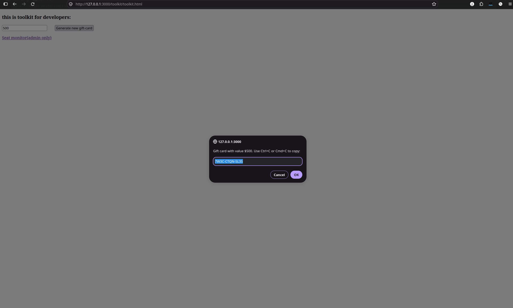
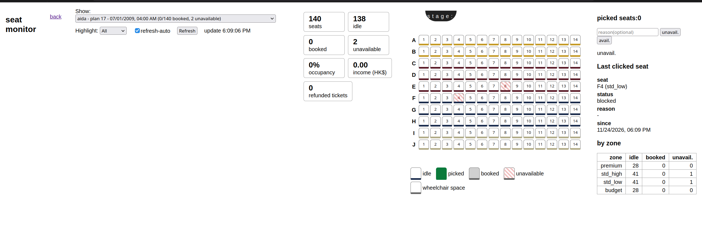

---

## 4 Algorithms and flowcharts
### 4.0 reference data
reference data from the database:
| Opera | Rating | Duration (min) |
| --- | --- | --- |
| The Marriage of Figaro | `9.2` | `180` |
| Don Giovanni | `8.9` | `165` |
| The Barber of Seville | `8.7` | `160` |
| La Boheme | `9.5` | `140` |
| Tosca | `9.0` | `130` |

### 4.1 sort

|search|best case|worst case|average|stability|extra space|
|:--:|:--:|:--:|:--:|:--:|:--:|
|selection| $O(n^{2})$ | $O(n^{2})$|$O(n^{2})$|no|$O(1)$|
|insertion| $O(n)$       |$O(n^2)$|$O(n^2)$|yes|$O(1)$|
|merge|     $O(n \log{n})$|$O(n\log{n})$|$O(n\log{n})$|yes|$O(n)$|
|quick|     $O(n \log{n})$   |$O(n^{2})$(rare)|$O(n\log{n})$|no|$O(\log{n})-O(n)$ (stack)|
|bubble|    $O(n)$       |$O(n^2)$|$O(n^2)$|yes|$O(1)$

#### 4.1.1 selection sort

It is used for duration, shortest first. it repeatedly find the smallest item in the unsorted part and swaps it to the front.  
One of its advantages is that it makes at at most $(n-1)$ swaps, which is considered efficient,  
while one of its disadvantages is that it is not stable.  
Several operas in my data share the same duration (150 minutes),so their order after sorting may differ from the original order.  


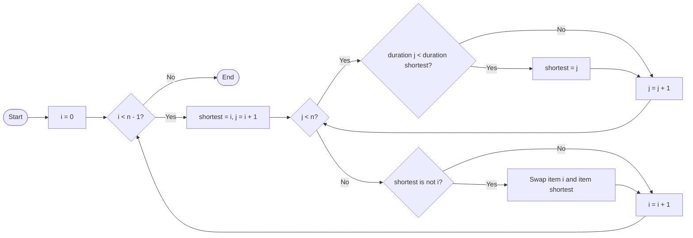

*Trace (durations 180, 165, 160, 140, 130):*
| i | Position of the smallest | List after the pass |
| --- | --- | --- |
| 0 | 4 (130) | `130`, `165`, `160`, `140`, `180` |
| 1 | 3 (140) | `130`, `140`, `160`, `165`, `180` |
| 2 | 2 (160) | no swap |
| 3 | 3 (165) | no swap |

#### 4.1.2 Insertion sort
It is used for sort by show time, earlist first.

Each new item is inserted into the already sorted part on its left, so it's highly effective when the list is nearly sorted,while being stable.

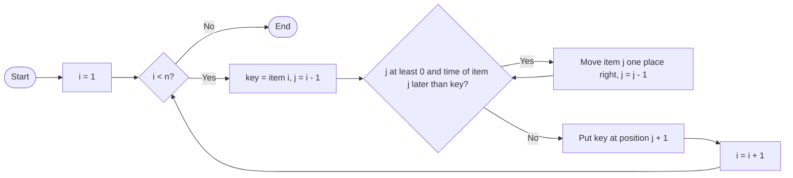
*Trace (day of the month of four performances: 25, 12, 29, 20):*

| Key | List after inserting it |
| --- | --- |
| 12 | 12, 25, 29, 20 |
| 29 | 12, 25, 29, 20 (nothing moves) |
| 20 | 12, 20, 25, 29 |

#### 4.1.3 Merge sort

This is used for sort by name, alphabetically from ***a*** to ***z***, ignoring upper or lower case.

The list is cut in half, each half is sorted by recursion, and the two sorteed halves are merged back. it always take $O(n\log{(n)})$ time but needs $O(n)$ extra space.

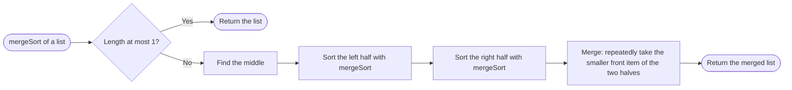

*Trace (five names):* 
- **split** into { Marriage of Figaro, Don Giovanni } and { La Boheme, Tosca, Barber of Seville };  
- **split again** until each part has one name;  
- **merge back**: **D**on Giovanni, **L**a Boheme, **T**he Barber of Seville, **T**he Marriage of Figaro, **T**osca. 


#### 4.1.4 Quick sort


It is used for ranking the search results and building the sorted name index.  

The algorithm uses a **Stack** instead of recursion.
This is how it works:  

1. **picks a pivot** as the median of the first, middle and last item,  
2. **splits the range** into "smaller/equal/larger than the pivot",
3. **pushes the two outer ranges on the stack**.the smaller one is processed first , so the stack stays short.

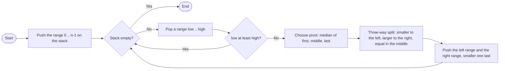

*Trace of the first pass (list 5, 3, 8, 1, 9, 2, 7; first = 5, middle = 1, last = 7, so the pivot is 5):*

| Step | Action | List |
| --- | --- | --- |
| 1 | 3 < 5: swap with the first free place | 3, 5, 8, 1, 9, 2, 7 |
| 2 | 8 > 5: swap with the last unchecked item | 3, 5, 7, 1, 9, 2, 8 |
| 3 | 7 > 5: swap with the last unchecked item | 3, 5, 2, 1, 9, 7, 8 |
| 4 | 2 < 5: swap with the first free place | 3, 2, 5, 1, 9, 7, 8 |
| 5 | 1 < 5: swap with the first free place | 3, 2, 1, 5, 9, 7, 8 |
| 6 | 9 > 5: swap with the last unchecked item, stop | left `[3, 2, 1]`, pivot 5, right `[9, 7, 8]` |


#### 4.1.5 Bubble sort


This one is used both for sort by price and by rating.

Neighbouring items are compared and swapped when they are in the wrong order, so the smallest item sinks to the end in every pass. if a whole pass has no swap, the list is sorted and the algorithm stops early.

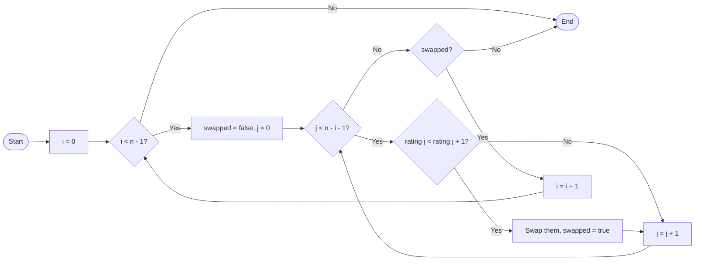

*Trace (ratings 9.2, 8.9, 8.7, 9.5, 9.0):*

| Pass | List after the pass | Swap? |
| --- | --- | --- |
| 1 | 9.2, 8.9, 9.5, 9.0, 8.7 | yes |
| 2 | 9.2, 9.5, 9.0, 8.9, 8.7 | yes |
| 3 | 9.5, 9.2, 9.0, 8.9, 8.7 | yes |
| 4 | 9.5, 9.2, 9.0, 8.9, 8.7 | no, stop |


### 4.2 Others

#### 4.2.1 fuzzy search-levenshtein distance

(Note that this part is not required and included in the syllabus, but this significantly enhances ui/ux)

The levenshtein distance is the smallest number of insertions/deletions/substitutions that turns one string into another.
A member who types `ada` still finds `aida`, becaude the distance between the two words is $1$:

the result is $1$: one inserted `i`. the time and space needed for this algorithm are $O(m*n)$ for string of length $m$ and $n$, which is small for opera names.

Ranking :the distance is only used when:
- the text is neither equal to a name (score=$-2$);
- the text is not a part of a name (score=$-1$)

All scores are then sorted with quick sort; If two scores are equal, the original position is the tie-breaker, so the ranking is stable.

Some opera names in the database are short lowercase codes (e.g. `aida` and `carmen`), and some are full titles(e.g.`The Marriage of Figaro.`).The text and names are converted to lowercase and trimmed before comparing, so both kinds are found.

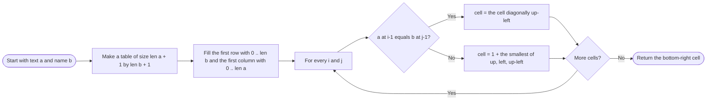
*Trace for `ada` and `aida`:*

|/ | (empty) | a | i | d | a |
| --- | --- | --- | --- | --- | --- |
| (empty) | 0 | 1 | 2 | 3 | 4 |
| a | 1 | 0 | 1 | 2 | 3 |
| d | 2 | 1 | 1 | 1 | 2 |
| a | 3 | 2 | 2 | 2 | **1** |

#### 4.2.2 Linear search& Binary search

`OperaSearchIndex` keeps a copy of the operas sorted by name (using [quick sort](#414-quick-sort)).  
An exact name is found by binary serch: start by looking at the middle item, then continue in the hald where the name can be, so each step removes half of the items. 
It need $O(\log{(n)})$ steps.
while the linear search used for **part of a name** needs $O(n)$ steps.


---

## 5 implementation

This chapter includes short extracts from the source files.  
Each section implements a step in chap3 or a box of a flowchart in [chap.4](#4-algorithms-and-flowcharts).

### 5.1 Seat grid

This part groups seats by row,  
with reference to `front-end/book/seats.js`  
featuring [#3.3 choose seats](#33choose-seats)  

```js
export function groupByRow(seats) {
    const rows = new Map();
    for (const seat of seats) {
        if (!rows.has(seat.row)) rows.set(seat.row, []);
        rows.get(seat.row).push(seat);
    }
    for (const list of rows.values()) list.sort((a, b) => a.col - b.col);
    return rows;
}
```

A `Map` collects the seats of each row letter, and each row is sorted by seat number, so the seat map can be drawn rows one by one.the same function draws the booking page and the admin page too.


### 5.2 Seat price

With reference to `front-end/book/seats.js`  
Featuring [#3.3 choose seats](#33choose-seats) and price step of *Fig.5*  
```js
export function seatUnitPrice(zonePrice, multipliers, audience) {
    const found = multipliers.find(m => m.name === audience);
    const multiplier = found ? Number(found.multiplier) : 1;
    return Math.round(Number(zonePrice) * multiplier * 100) / 100;
}
```
note that the multiplier comes from table `lv`,an unknown type falls back to `1`.
multiplying by 100 before `Math.round()` and dividing afterwards rounds to nearest cents,
as a result, the browser and the server will show the same total amount of price 

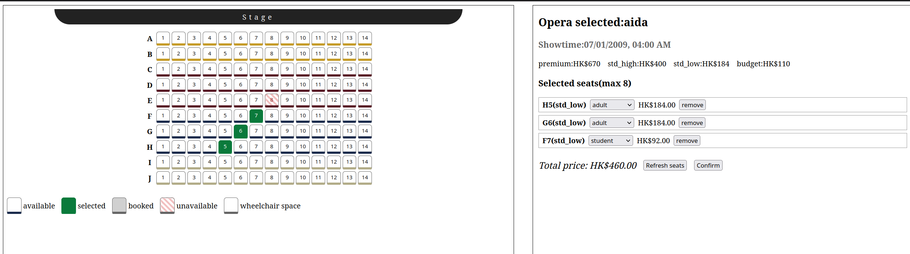


### 5.3 levenshtein distance

Featuring [# 4.2.1 fuzzy-search, levenshtein-distance](#421-fuzzy-search-levenshtein-distance).  
Note that `arr` is the table of the trace in this section.  
with reference to `front-end/search/search.js`.
```js
function levenshtein(searchInput, data) {
    const a = searchInput.length;
    const b = data.length;
    const arr = [];
    for (let i = 0; i <= a; i++) {
        arr[i] = [];
    }
    for (let i = 0; i <= a; i++) {
        arr[i][0] = i;
    }
    for (let j = 0; j <= b; j++) {
        arr[0][j] = j;
    }
    for (let i = 1; i <= a; i++) {
        for (let j = 1; j <= b; j++) {
            if (searchInput[i - 1] === data[j - 1]) {
                arr[i][j] = arr[i - 1][j - 1];//inherite last result in previous diagonal block if no change is made
            } else {
                arr[i][j] = Math.min(
                    arr[i - 1][j] + 1,    // Del
                    arr[i][j - 1] + 1,    // Insert
                    arr[i - 1][j - 1] + 1 // Sub
                );
            }
        }
    }
    const result = arr[a][b];
    return result;
}
```

Equal letters copy the diagonal value, otherwise the smallest of (`deletion`/`insertion`/`substitution`) +1 is taken.

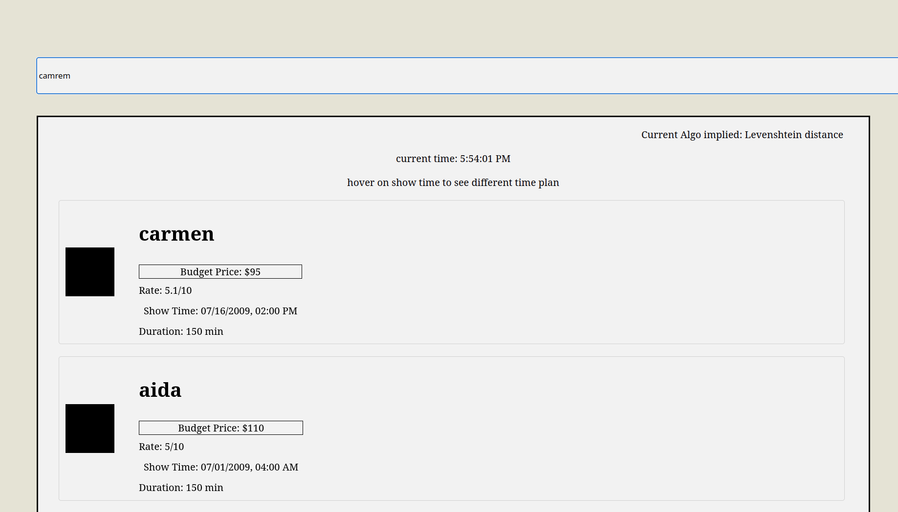

### 5.4 Merge sort


Featuring [# 4.1.3, merge-sort](#413-merge-sort)  
With reference to `front-end/search/sort.js`  

```js
export function merge_name(data = []) {
    if (data.length <= 1) {
        return data;
    }

    const middle = Math.floor(data.length / 2);
    const left = merge_name(data.slice(0, middle));
    const right = merge_name(data.slice(middle));
    const merged = mergeHalves(
        left,
        right,
        (a, b) =>
            String(a.name ?? a.id).localeCompare(
                String(b.name ?? b.id),
                undefined,
                { sensitivity: 'base' }
            )
    );

    for (let i = 0; i < merged.length; i++) {
        data[i] = merged[i];
    }

    return data;
}
```

It is worth noting that this function(`merge_name()`) calls it self on both halves, which uses **recursion**,  
and `localCompare` with `sensiticity:'base'` ignores upper and lower case.


### 5.5 Payment transaction

Features *Fig.5*  
With reference to `back-end/serv-main/serv-main.js`, extracted from route `/PaymentOrder`.  

```js
client=await pool.connect();//initialize a client for database connection

await client.query('begin')//symbolize the begin of record of a transaction
//lock seats, check seat status, calculate total price, check remaining wallet balance..
const orderRes = await client.query(mainsql.refund_selectOrder, [order_id, user]);
const walletRes = await client.query(mainsql.refund_updateWallet, [refundAmount, order.uid]);
//save the wallet record, then generate and distribute one ticket per seat
await client.query('commit')//confirm and record the transaction
//since the code above is nested inside a try in order to prevent unexpected error ruin the whole process,
//in catch, await client.query('rollback'),
//in finally, client.release(), which returns the client back to the pool for future borrowing
```

It is worth noting that all transaction-related statements use the same database conection `client`, with is essential here, because a transaction only works if `begin`, and changes and `commit` or `rollback` go through one connection.
Any step fails would lead to a `rollback` action which undoes eveything.


### 5.6 Locking seats 

Featuring *Fig.5*  
With reference to `back-end/queries.js` and `back-end/user.sql`  

```js
const seat_lock = `select seat_id, row_label, col_no, zone, is_accessible from seat where seat_id = any($1::int[]) order by seat_id for update`
```

`for update` append at the last of the query sentence makes a second payment wait until the first one finishes

```sql
create unique index if not exists ux_ticket_live_seat on ticket(pid,seat_id) where voided_at is null;
```

and the unique index refuses a second valid ticket even if something slips through.

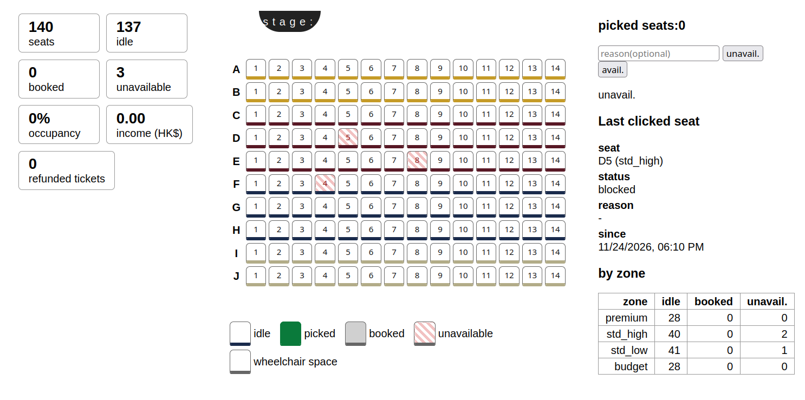
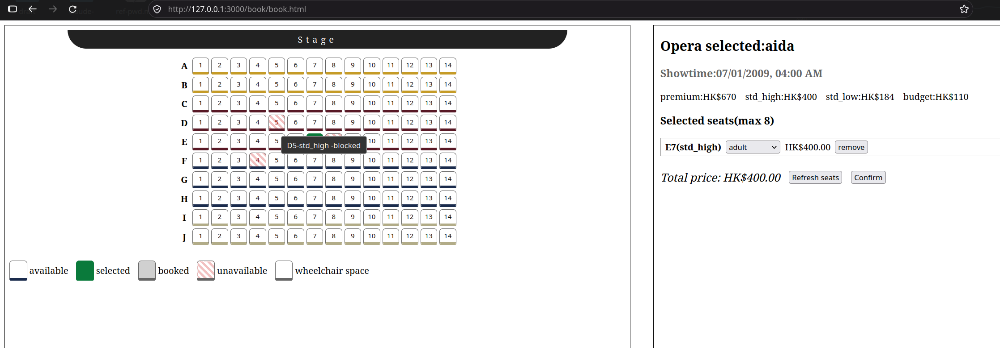


### 5.7 Seat monitor counting

Featuring [3.8 admin tools](#38-admin-tools)  
With reference to `back-end/serv-main/serv-main.js`, route `/toolkit/seat_status`  


```js
rows.forEach(row => {
            summary[row.state] += 1;
            if (row.state === 'booked') summary.revenue += Number(row.unit_price);
            if (!summary.byZone[row.zone]) summary.byZone[row.zone] = { idle: 0, booked: 0, blocked: 0 };
            summary.byZone[row.zone][row.state] += 1;
        });

```

One pass over the 140 rows fills the totals and the table by zone.  
`unit_price` is converted by `Number()` because PostgreSQL returns a `numeric` value as text.


### 5.8 Password hashing

Features [#3.4, authentication](#34-authentication)  
With reference to `back-end/serv-utils/serv-utils.js`  
```js
export function hash(pwd, salt) {
    return new Promise((resolve, reject) => {
        if (typeof pwd !== 'string' || typeof salt !== 'string') {
            reject(new TypeError('Password and salt must be strings.'));
            return;
        }

        crypto.scrypt(pwd, salt, 64, (error, derivedKey) => {
            if (error) {
                reject(error);
                return;
            }

            resolve(derivedKey.toString('hex'));
        });
    });
}
```
Note that only salt and this hash are stored in the database, so a stolen database does not contain any passwords.

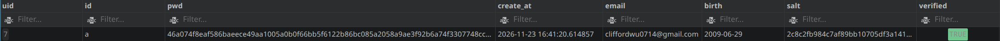

---


## 6 boundary case,test,error track

### 6.1 Boundary and error cases

| Case | Expected behaviour | Handled in |
| --- | --- | --- |
| 8 seats / 9 seats in one order | 8 accepted, 9 rejected | Browser and `/PaymentOrder` (`MAX_SEATS = 8`) |
| Two members pay for the same seat | The later one gets 409 `seat_taken` and is not charged | `seat_lock` (`FOR UPDATE`), unique index |
| A seat the administrator made unavailable | 409 `seat_blocked` | `/PaymentOrder` |
| Wheelchair ticket for an ordinary seat | 400 `wheelchair_needs_accessible_seat` | `/PaymentOrder`, browser option disabled |
| The total is edited in the browser | Ignored; the server calculates the price | `/PaymentOrder` |
| Balance lower than the total | `insufficientBalance`, nothing is saved | `/PaymentOrder` |
| Balance exactly equal to the total | Payment accepted, balance becomes 0 | `/PaymentOrder` |
| Refund of an order that is already refunded | `not_refundable` | `/refundOrder` (status is checked after the row is locked) |
| Gift code used twice | `already redeemed` | `/redeem` |
| Expired or used verification / reset link | Refused | `expire_time > NOW()` and `used = FALSE` in the query |
| Sign in before verifying the email | Refused | `/auth/login` |
| Weak password | Every broken rule is listed | `validatePassword` |
| Empty search box / no match | All operas / ranked by distance | `AccordingToSearchBar` |
| First and last page of the results | *Previous* / *Next* disabled | `renderPage` |
| Administrator blocks a booked seat | 409 `seat_booked`, nothing changes | `/toolkit/seat_block` |


### 6.2 constraints and limitations
1. Seats are not held: if two members pay at the same moment, the slower one is told after pressing *Confirm* that the seat he/she chosed was taken.  
It is accepted because a hold would need timers and release rules which is not a mandatory feature need to be added.
2. A refund covers a whole order, not one ticket.
3. The server does not issue a login credential. A request to `/PaymentOrder` or `/refundOrder` only contains a user name, so the system is only suitable for a coursework demonstration for now.
4. The administrator tools are protected only by a password prompt in the browser; the `/toolkit/...` routes have no server-side check ([section3.8](#38-admin-tools)).
5. A new email address is saved without a new verification email, and the update routes (like the payment and refund routes) only receive a user name, so they are only suitable for a demonstration ([section3.7](#37-settings)).
6. The seats are remembered across the sign-in only in the same browser, and only for one return to the seat page ([section3.4](#34-authentication)).
7. Payment is simulated with a wallet.
8. Performance dates in the sample data are in 2009;  this only affects what is displayed.


### 6.3 error track

All errors are tracked and logged with `console.log` or `console.error` in the server terminal.  
Failed database steps are rolled back and answered with an HTTP status:
- 400, invalid input;
- 409, conflict
and a brief message.


---
## 7 .tests

---

## 8 improvement and eval


---


with reference to:

inspiration and ui/ux design:  
https://urbtix.hk

font used:  
https://fonts.google.com/

mailersend api  
https://www.mailersend.com

introduction to the opera ***Carmen*** in the home page:  
https://en.wikipedia.org/wiki/Carmen

lyrics of the aria "l'amour est un oiseau rebelle" in the home page used for decoration purposes:  
https://www.pinterest.com/pin/199988039694668685/
