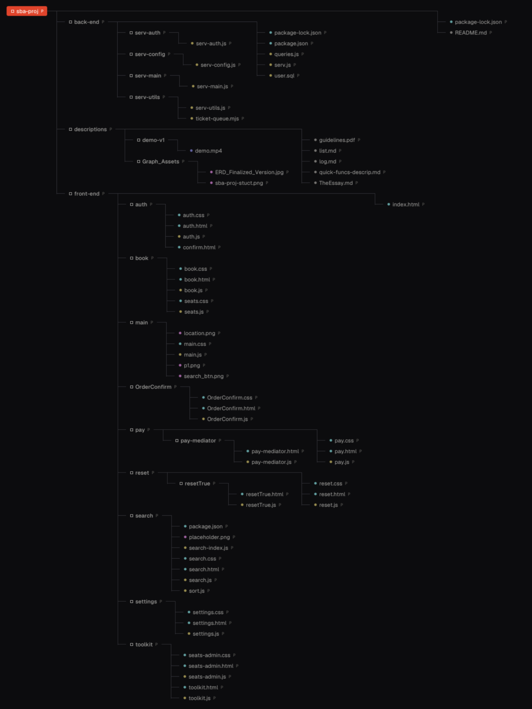
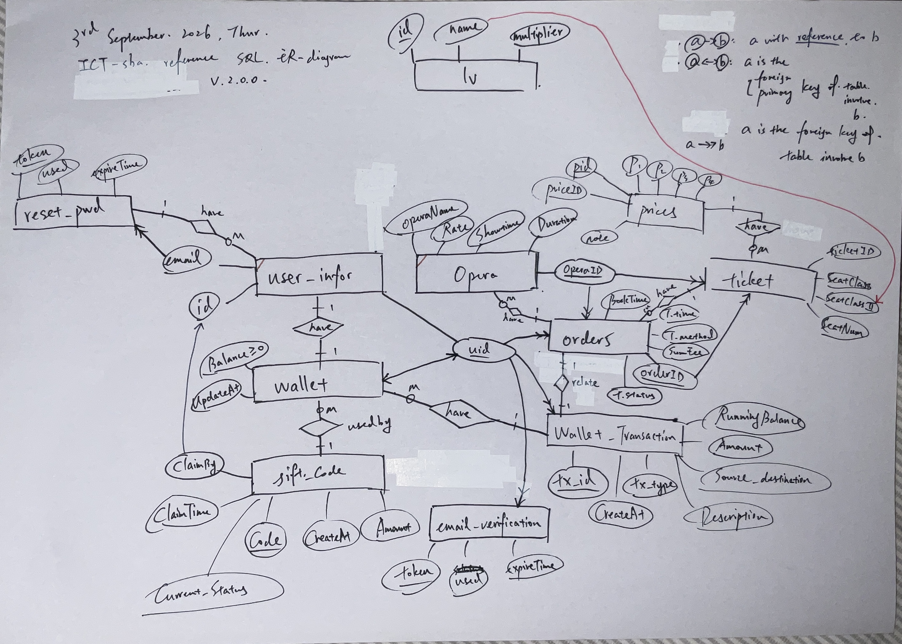

# ICT SBA Project, 2027 DSE,
## Clifford Wu Jia An, St Paul's College

## 1 intro.

**This** ict sba  project is an *opera ticket booking system* following the [guidance](guidelines.pdf).
it includes:
- 15 different operas,with 2 show for each opera,140 seats available for booking  *(i.e. in total of 15*2*140=4200 available option)* 

- allow user to search, book, make payments, and refund.
- virtual payment process

main features including:
- sign in/up authentication
- different sorting algorithms

---

## 2 database design

### 2.1 database ERD graph

| table(abbr)                   |primary key   |foreign key| constraints|use 
|:--:                           |:--:          |:--:        |:--:|:--:|
| user_infor *(u)*              |u.uid         |-|-|store user-relate data|
|  wallet *(w)*                 |w.uid         | w.uid ref u.uid |balance>=0 |  store user balance|
|gift_code *(gc)*               |gc.code       |gc.cliam_by ref u.uid |- |gift code|
|email_verification *(ev)*      |ev.token      |ev.userid ref u.uid |- |signup token|
|pwd_reset *(pr)*               |pr.token      |-    |- |reset token|
|opera *(op)*                   |op.opera_id   |- |op.rate<=10.0 |opera data|
|prices *(p)*                   |p.pid         | p.opera_id ref op.opera_id| -|store prices|
|lv                             |lv.id         |- |- |multipliers|
|orders *(or)*                  |or.order_id   |or.uid ref u.uid | -|store order details|
|seat *(s)*                     |s.seat_id     | -| s.zone in designated value|seat data|
|seat_block *(sb)*              |sb.pid        | sb.pid ref p.pid sb.seat_id ref s.seat_id|-|blcoked seat&reason|
|ticket *(t)*                   |t.ticket_id   |t.opera_id ref u.uid t.order_id ref or.order_id t.pid ref p.pid t.seat_id ref s.seat_id;  |- |ticket data|
|wallet_transaction *(wt)*      |wt.tx_id      |wt.uid ref u.uid wt.order_id ref or.order_id |wt.amount>0 wt.tx_type in designated value | transac history|

#### 2.1.1 3nf design declaracion

### 2.1.2 quick look up index
- unique index ux_ticket_live_seat
- index idx_wallet_tx_uid_date

### 2.2 data structs

hash map /updateOperaData
**struct,position,why use such struct, what if not use**

#### 2.2.1 stack
refers to `sort.js`:
#### 2.2.2 queue
refers to `ticket-queue.mjs`
#### 2.2.3 linked list

#### 2.2.4 set
refers to (by grep -rl)
front-end/OrderConfirm/OrderConfirm.js
front-end/toolkit/seats-admin.js
front-end/search/search.js
front-end/book/book.js
front-end/book/seats.js
back-end/serv-main/serv-main.js
#### 2.2.5 map(hashmap)
serv-util.js
#### 2.2.6.1 Array(1d)

#### 2.2.6.2 Array(2d)
reference to [levenshtein distance](#421-fuzzy-search-levenshtein-distance)
#### 2.2.7 Object

#### 2.2.8 json
commonly used in this project for front-backend data transmission with credit to its lightweight and readability to both programmer and server.

---

## 3. features
**main process line graph(stepwise refinement)**
**purpose-procesure(conditional t/f flowchart)-relevant file/funcs/routes(table)-what if fail-screenshot?**

### 3.1 authenticaiton
serv-auth.js : POST /auth/signup、GET /auth/:token、POST /auth/login、POST /reset、GET /reset/:token、POST /reset/updatepwd；serv-utils.js: hash(pwd, salt)、validatePassword；
// auth.html / auth.js。
### 3.2 search/browse
search.html、search.js（AccordingToSearchBar、executeSearch、renderPage、createOperaArticle）、sort.js、search-index.js。
*mention sort use for filter*
*sort algo indicator in search.html*
### 3.3choose seats
book/seat,post seatmap
The seat map has 140 seats in ten rows (A–J). A seat can be idle, selected, booked or unavailable; booked and unavailable seats cannot be clicked.
### 3.4 pay
pay.html / pay.js、pay-mediatorOrderConfirm.js；
POST /PaymentOrder、POST /SendConfirmationEmail

**flowchart required!!**
persimmistic lock
### 3.5 Wallet, refund
settings:POST /settingGetData、/settingsGetOrders、/refundOrder、/redeem；
sql: wallet、wallet_transaction、orders、ticket、gift_code
### 3.6 admin.tools
front-end/toolkit/：toolkit/seats-admin
back-end /toolkit/gen_redeem_code、/toolkit/sessions、/toolkit/seat_status、/toolkit/seat_block。
---

## 4 algos and flowcharts

### 4.1 sort

|search|best case|worst case|
|:--:|:--:|:--:|
|||
|||
|||
|||
#### 4.1.1 selection sort

#### 4.1.2 insertion sort

#### 4.1.3 merge sort

#### 4.1.4 quick sort

#### 4.1.5 bubble sort

### 4.2 others

#### 4.2.1 fuzzy search-levenshtein distance
example reference table required
o-notation

#### 4.2.2 linear search&binary search
search-index.js binarySearch、linearSearch、findExact、findPartial

#### 4.2.3 sum price and unit price calculation
`seatUnitPrice`
per*multiplier
---

## 5 implementation

### 5.1 seat

### 5.2 seat-price

### 5.3 search

### 5.4search-II-sort

### 5.5 transac

### 5.6 admin/seat-stat

### 5.8 auth/validate

---
## 6 boundary case,test,error track

---

## 7 .test/user feedback(?)

---

## 8 improvement and eval

---

with reference to:

inspiration and ui/ux design:
https://urbtix.hk

font used:
https://fonts.google.com/
