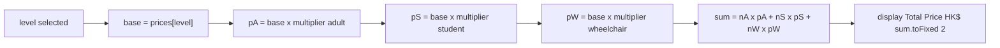
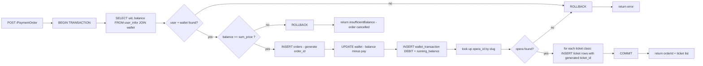
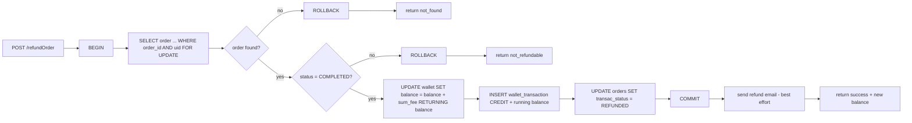
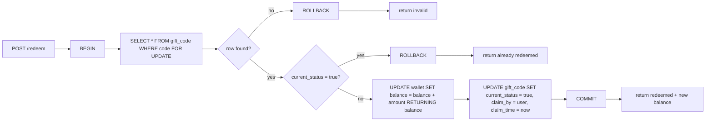
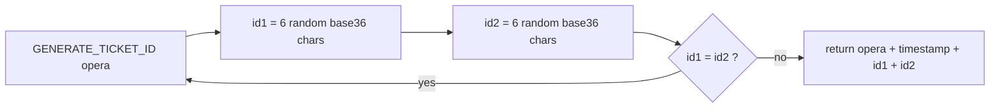
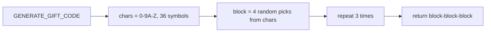
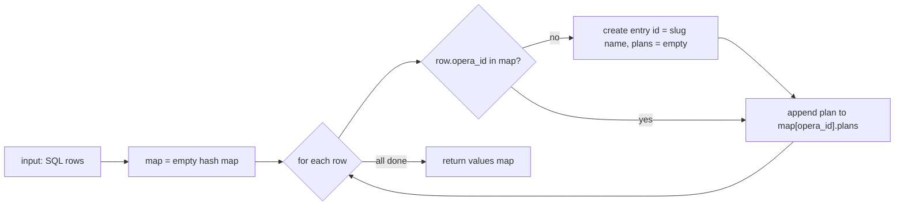

| Guidelines requirement | Where this essay covers it |
| :--- | :--- |
| Task 1(a) — suitable data types & data structures                     | §2 (schema, tables, JS structures), §5 |
| Task 1(b) — searching and displaying events                           | §4.1–4.4 (Levenshtein fuzzy search, ranking, sorting, pagination) |
| Task 1(c) — booking, seat/time-slot selection, payment simulation     | §5, §6 (dynamic pricing, wallet transaction) |
| Task 1(d) — stepwise refinement of the main menu loop & key features  | §2.4 (user-journey flowchart), plus a flowchart per feature |
| Task 1(e) — flowcharts for the algorithms in (d)                      | every Mermaid flowchart in this essay |
| Task 2 — testing & evaluation                                         | §8 (debugging, marginal cases, portability, feature extension) |

### 5.2 Seat-class multipliers and the total-price formula (`book.js`)

The database `lv` table stores multipliers per audience type (adult / student / wheelchair). The book page computes per-ticket prices and the total `sum_fee = nA·pA + nS·pS + nW·pW`, where each `px = base × multiplier(type)`:

The quantity steppers clamp at zero (`minus` only decrements while `currentVal > 0`, `book.js:158-160`) — another marginal case handled at the UI level. The result object is serialised to `localStorage['details']` and later consumed by `pay.html` and the backend `PaymentOrder`.

---
---

## 6. Payment, Wallet and Concurrency Constructs and limitations

### 6.1 payment workflow — `/PaymentOrder` (`serv-main.js:191-239`)

The payment workflow writes to `orders`, `wallet`, `wallet_transaction`
and `ticket`. These changes should belong to one database transaction so
that a failure does not leave a partially completed purchase.

The current implementation issues `BEGIN`, `COMMIT` and `ROLLBACK` through
`pool.query()`. However, node-postgres requires all statements in a
transaction to use the same checked-out client. Transaction atomicity
therefore remains an implementation limitation until the queries are moved
to one client and the failure paths are tested. 

### 6.2 Pessimistic locking — `SELECT … FOR UPDATE`

* Password reset locks the token row before checking and consuming it.
* Gift-code redemption locks the code row before checking its status.
* Refund processing locks the order row before checking whether it is
  still eligible for a refund.

These checks are intended to prevent repeated processing. Their
concurrency guarantees require the transaction-client correction
described in §6.1 and subsequent concurrent-request testing.

These locks must be held within correctly managed transactions. The
presence of `FOR UPDATE` alone is not sufficient evidence that the current
application is safe under concurrent requests. 

* **Password reset consumption** — `pwd_reset` row locked while being consumed (`serv-auth.js:149`).
* **Gift-code redemption** — the `gift_code` row is locked before the `current_status` check (`serv-main.js:117`), so two users cannot both redeem the same code (double-spend protection).
* **Refund** — the `orders` row is locked before re-checking `transac_status = 'COMPLETED'` (`serv-main.js:56-63`), so a double-click cannot refund the same order twice.

### 6.3 The refund pipeline (`serv-main.js:52-111`)

it reverses a whole order (limitation: whole orders only, not single tickets):

The front-end `settings.js` additionally filters out `REFUNDED` orders from the list and disables re-refund buttons.

### 6.4 Gift-code redemption (`serv-main.js:112-143`)

---
---

## 7. Utility Algorithms and Generators

### 7.1 Random identifier generation

**Verification / reset tokens** (`serv-utils.js:17-30`) use the platform CSPRNG: `crypto.randomUUID()` (a v4 UUID, 122 random bits) with hyphens stripped — collision-safe and unguessable.

**Ticket IDs** currently combine the opera name, a timestamp and two random
base-36 fragments. The function retries when the two newly generated
fragments are identical.

This comparison does not check whether the complete ID already exists in
the database. It should therefore not be described as database collision
detection. The retry also has no explicit upper limit.

**Gift codes** (`toolkit.js:8-13`) are 4-4-4 blocks over a 36-symbol alphabet (format matches the schema comment “4+1+4+1+4 = 14”):

Note: `Math.random()` is a PRNG, acceptable for coursework, though a CSPRNG would be the hardened choice for value-bearing codes (§8.4).

### 7.2 Hash-map aggregation — `/updateOperaData` (`serv-main.js:145-171`)

The SQL returns one row per (opera, price plan). The server folds them into nested objects in **O(n)** using a hash map keyed by `opera_id`, and derives the search slug (`lowercase`, spaces → `-`):

The same slug function (`LOWER(REPLACE(opera_name,' ','-'))`) is re-applied in SQL on the lookup side (`serv-main.js:177,215`), keeping front-end ids and database rows aligned.

### 7.3 Micro-constructs

Modulo-based cycling is used for the payment-processing animation:
`index = (index + 1) % texts.length` repeats the three display messages.
* **Order breakdown aggregation** in `settingsGetOrders`: SQL `GROUP BY` + `json_agg(json_build_object(...))` produces the per-class ticket counts without N+1 queries.
* **Zero-padding** for timestamps: `String(n).padStart(2,'0')` (`serv-utils.js:141-146`).

---
---

## 8. Testing and Evaluation (Guidelines Task 2)

The read-only review checked JavaScript syntax, frontend module linkage,
sorting behaviour, search-index operations, and Queue/LinkedList behaviour.

These checks did not execute the complete booking workflow, database
transactions or email delivery. Algorithm correctness should therefore be
reported separately from end-to-end system correctness.

The existing boundary-case table records expected behaviour. Actual
results, evidence and retest outcomes should be added after the
corresponding application tests are performed.

### 8.1 Debugging strategy

all errors can be tracked by `console.log` & infors printed in the terminal for debug purposes

### 8.2 Marginal and boundary cases

| Case | Expected behaviour | Where enforced |
| :--- | :--- | :--- |
| `wallet.balance < order price` | transaction rolled back, message `insufficientBalance`, user returned to home | `serv-main.js:201-204` |
| Double refund / refund after refund | `not_refundable` | status re-check under `FOR UPDATE` |
| Same gift code redeemed twice | `already redeemed` | status check under `FOR UPDATE` |
| Expired or used reset token | `Invalid or expired token` | `expire_time > NOW()` and `used = FALSE` |
| Unverified account logs in | `req. verify email first` | `serv-auth.js:96-98` |
| Ticket quantity minus at 0 | value stays at `0` | `book.js:158` |
| Price plan at exactly 12:00:00 | Plan 1 (≤ 43200); 12:00:01 → Plan 2 | `serv-utils.js:131` |
| Pagination at first / last page | Prev/Next disabled; page index clamped | `search.js:188-202` |
| Empty search box | all weights equal, stable order = original catalogue | `search.js:207-215` |

---

***All file references are relative to the repository root `sba-proj/`.*
**

reference:

[URBTIX. Official website. Interface and booking-flow inspiration.](https://urbtix.hk)

---
design( (flowchart only , no code))
implementation(real code)
