# presentation essay 

### *author:Clifford,Wu Jia An*

## *date: 19th,October,2026, Monday*

## 0.Intro
this sba-project is a **full-stack opera ticket booking system**:
- user sign up/in,
- use redeem code to increase their left balance of their account
- search for operas they want to book
- buy and receive a notification email
- allow to refund

back-end is `Javascript` *(specifically node.js)* come together with a sql database

front-end is vanilla `html` ,`css` and `js` 

algo flowcharts are visualized by using `mermaid`.

---

## 1.main flow of the project

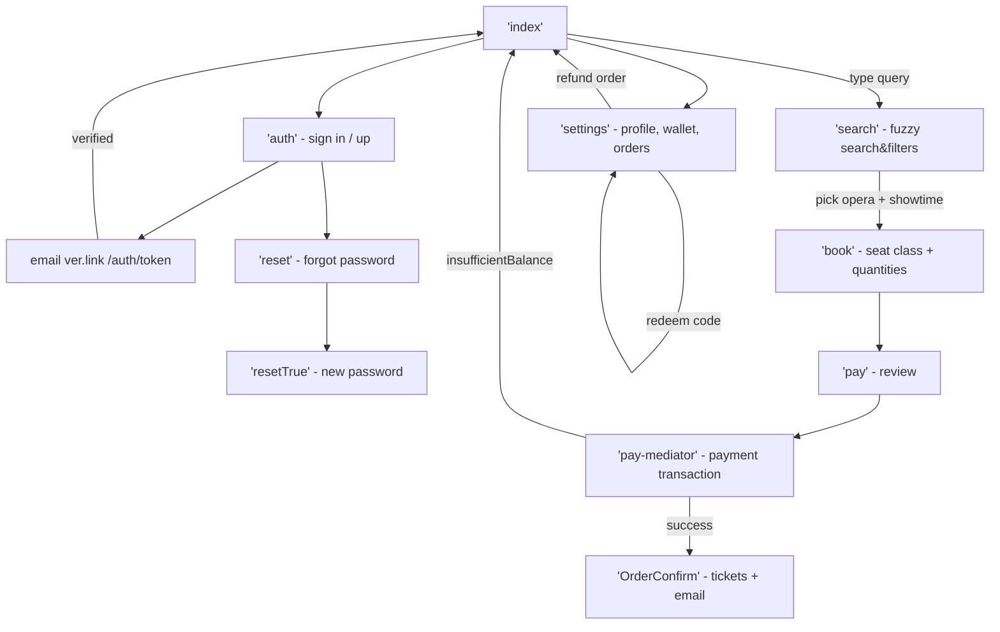

---

## 2.backend engine architcture& core structure

### 2.1 modular architecture

overall project folder structure reference(tool dev lcoally)

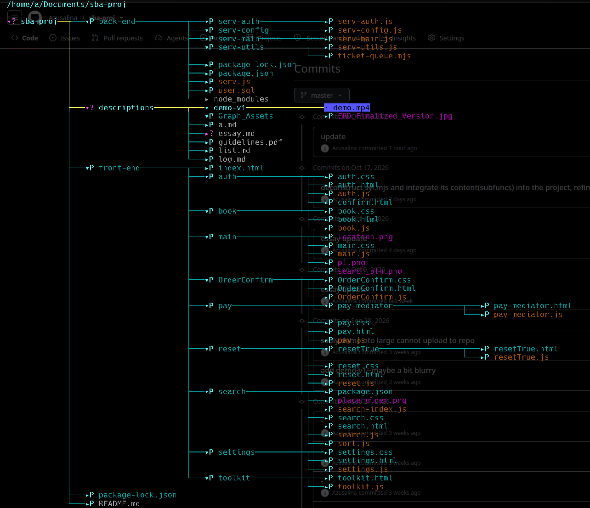

#### 2.1.1 frontend:

- for front-end, each page have its own dedicated `.js` file

- with search page specially append an extra series of `.js` files containing and in order to address data structures and sort algorihtms

#### 2.1.2 backend:

backend files were deconstructed into diffrent modules according to their features, namely:

|module | feature | algo |
| :---  | :---    | :--- |
|  `serv.config.js` |    config files, like api keys and sql pool connection | env var config |
| `serv-utils.js` | sub functions(util.func) | salted hash,fetch pricePlan, mail templates |
| `serv-auth.js`  | auth-related works | signin/up, send verification/reset email |
| `serv-main.js` | main workflow price/payment/refund/giftcode | payment,perssimistic lock, ledger double-entry |
| `serv.js` | mounts all routes | start the server |

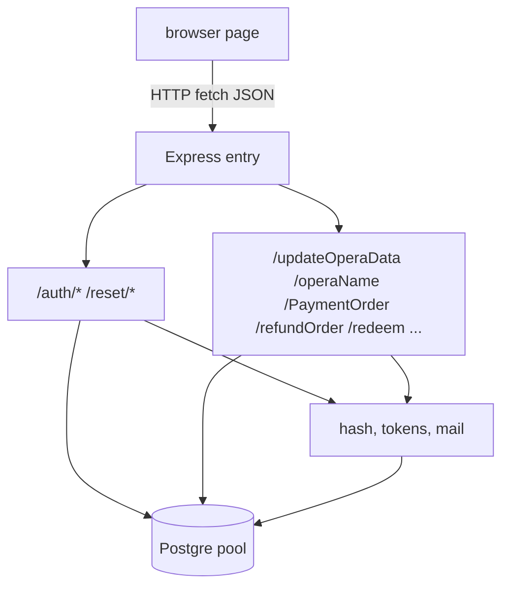

### 2.2 database

ref table below:

 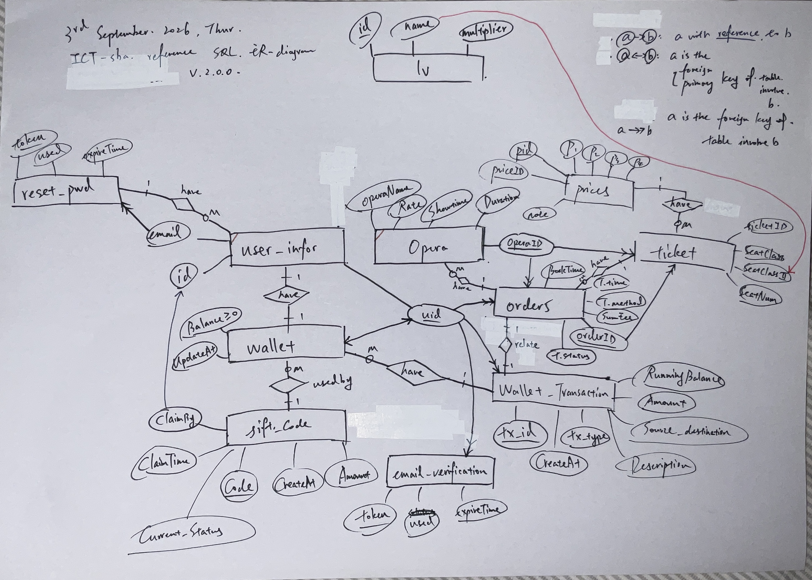

### 2.3 data structures

data structures below  are implemented in search, booking and ticket-generation modules. 
| Structure | Concrete form | Where |
| :---      | :---          | :--- |
| 2-D array | Levenshtein DP matrix |  `levenshtein()` |
| Array / list | opera list `Final`, sort | frontend operaList display |
| Hash map | `operaMap` grouping rows by `opera_id` |  `/updateOperaData` |
| Object / record | `details` object passed between pages | `pay.js` |
| JSON serialisation | `localStorage.setItem('details', JSON.stringify(details))` | `book.js` |
| Stack | explicit array-backed stack storing quicksort ranges | `front-end/search/sort.js` |
| Queue | FIFO ticket generation during payment | `back-end/serv-utils/ticket-queue.mjs` |
| Linked list | array-backed nodes connected by integer indices, used by Queue | `back-end/serv-utils/ticket-queue.mjs` |
| Relational tables | Postgre tables  | `user.sql` |

`localStorage`  is used to transport values or variables such as content in search bar between different pages.
 - write with `setItem` 
 - read with `getItem`
 - remove with `removeItem` (`main.js` logout).

key list:
 - `search_content`
 - `selected`
 - `selected_price_id` 
 - `selected_time` 
 - `details` 
 - `user` 
 - `isLoggedIn` 
 - `orderId` 
 - `tickets`. 

---

 ### 3 auth part

 #### 3.1 salted hash encryption

it should be pointed out that passwords are not stored hardcodely in the database;
hash encrypted result(`serv-utils.js:13-15` , `crypto.scrypt` ) 

is mixed with generated salt(`crypto.randomBytes(16)`) 

to form a salted hash password, therfore two users with the same password produce different digests (defeating rainbow-table attacks). On login, the stored salt is fetched and the same digest is recomputed and compared.

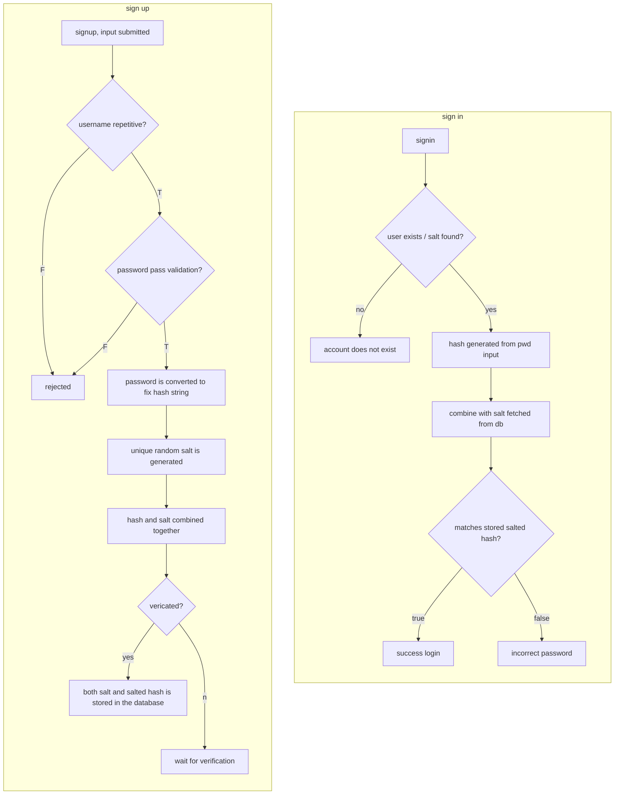
 ### 3.2 password validation

refer to the five rules[wiki](https://en.wikipedia.org/wiki/Password_policy)

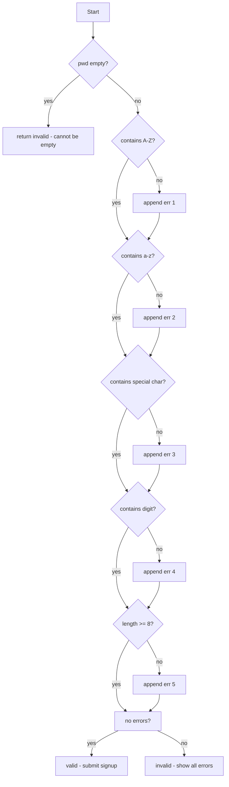

### 3.3 verification email and password reset

both shares:
*  a **cryptographically random single-use token with an expiry timestamp**,
 *  stored in its own table and checked with a guarded transaction:

| Property | Email verification | Password reset |
| :--- | :--- | :--- |
| Token source | `crypto.randomUUID()` minus hyphens (128-bit) | same |
| Table | `email_verification` | `pwd_reset` |
| Expiry | `NOW() + INTERVAL '1 day'` | `NOW() + INTERVAL '15 minutes'` |
| Single-use | `used BOOLEAN DEFAULT FALSE` | same |
| Race protection | check `used = FALSE` | `SELECT … FOR UPDATE` + `used = FALSE` |
| Side effect | `verified = TRUE`, wallet row created (`ON CONFLICT DO NOTHING`) | new salt + new digest stored |

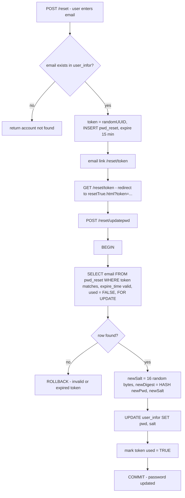

---

## 4 search and sorting algorithms

### 4.1 Fuzzy search: Levenshtein edit distance (dynamic programming)

**Requirement**: users should be able to find an opera even with typos *(e.g.“carnen” must find “Carmen”).*

`search.js:61-89` is the classic **Levenshtein distance** computed by **dynamic programming** over an `(m+1) × (n+1)` integer matrix.
The allowed edits are insertion, deletion and substitution, each costing 1.

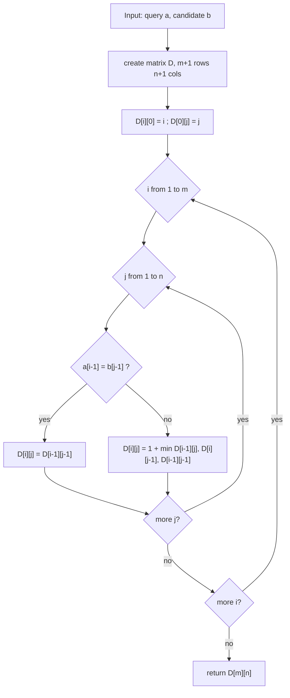

Complexity: **O(m·n) time and O(m·n) space**

**Worked example** — query `carnen` against candidate `carmen` (one substitution ⇒ distance 1):

| D | ∅ | c | a | r | m | e | n |
| :--- | ---: | ---: | ---: | ---: | ---: | ---: | ---: |
| **∅** | 0 | 1 | 2 | 3 | 4 | 5 | 6 |
| **c** | 1 | 0 | 1 | 2 | 3 | 4 | 5 |
| **a** | 2 | 1 | 0 | 1 | 2 | 3 | 4 |
| **r** | 3 | 2 | 1 | 0 | 1 | 2 | 3 |
| **n** | 4 | 3 | 2 | 1 | 1 | 2 | 2 |
| **e** | 5 | 4 | 3 | 2 | 2 | 1 | 2 |
| **n** | 6 | 5 | 4 | 3 | 3 | 2 | ***1*** |

Both the query and the candidate opera name are trimmed and converted
to lowercase before the edit distance is calculated. Spaces are retained;
the fuzzy comparison does not use the hyphenated opera slug.

- well, despite from search the target with a typo we also wish user can find the one they want by keywords or slices inside the word,

- for exmaple, users should be able to find la-traviata by the keyword `la-`

- therefore:

### 4.2 Keyword detection and relevance ranking (exact-match-first)

`AccordingToSearchBar()` assigns a score of −2 to an exact name match and −1 to partial name matches. Other candidates receive their Levenshtein distance as the score. Quicksort then orders the results by ascending score,
with the original catalogue position used to break ties.

`OperaSearchIndex` maintains a separate array sorted by normalised opera
name. `findExact()` applies binary search to this array, while
`findPartial()` uses linear search to collect names containing the query.

The binary-search phase takes **O(log n)** comparisons. Collecting partial
matches scans the catalogue in **O(n)** item visits, excluding the cost of
string comparisons. The complete search also performs fuzzy scoring
and relevance sorting, so its overall complexity is not **O(log n)**.

This search ranks the full catalogue rather than removing non-matching entries.

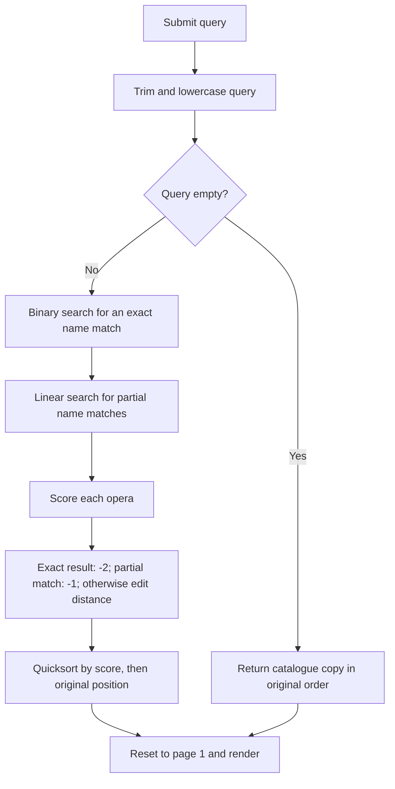

---

- we implemented several sorting algorithms included in the  `ict curriculum` via search page(`search.html`):

- for easier management and building, these sort sub-functions are stored in a dedicated utility file `sort.js`.

- thus:

### 4.3 sort algos (`front-end/search/sort.js`)

| Filter radio | Algorithm wired | Function | Order |
| :--- | :--- | :--- | :--- |
| name | merge sort (case-insensitive) | `merge_name()` | A→Z |
| time | insertion sort (adaptive) | `insertion_time()` | earliest→latest |
| price | bubble sort (early-exit) | `bubble_ascending_price()` | cheapest→dearest |
| rate | bubble sort (early-exit) | `bubble_ascending_rate()` | highest rating first |
| duration | selection sort | `selectionDuration()` | shortest→longest |

#### 4.3.1 Bubble

- Adjacent elements are compared and swapped, bubbling the largest element to the end of each pass. 
- exist `swapped` flag=> best case into **O(n)** (early exit on sorted input);
- worst/average remain ***O(n²)***. It is **stable** and in-place (***O(1)*** extra space).
- `bubble_ascending_rate()` uses the mirrored predicate, so despite its name it sorts **descending** — highest rating first, which is the desired UX.

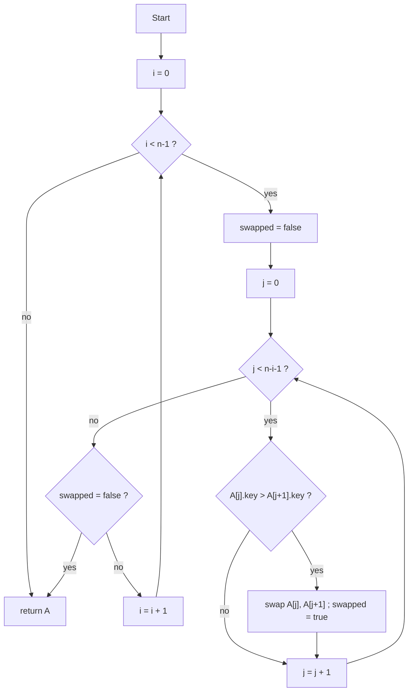

#### 4.3.2 Selection

Each pass finds the minimum of the unsorted suffix and swaps it into place.
- Always **O(n²)** comparisons,
- **O(n)** swaps, **unstable**, in-place. 

The duration option calls `selectionDuration()`. Each pass locates the
shortest remaining opera and swaps it into the next output position.

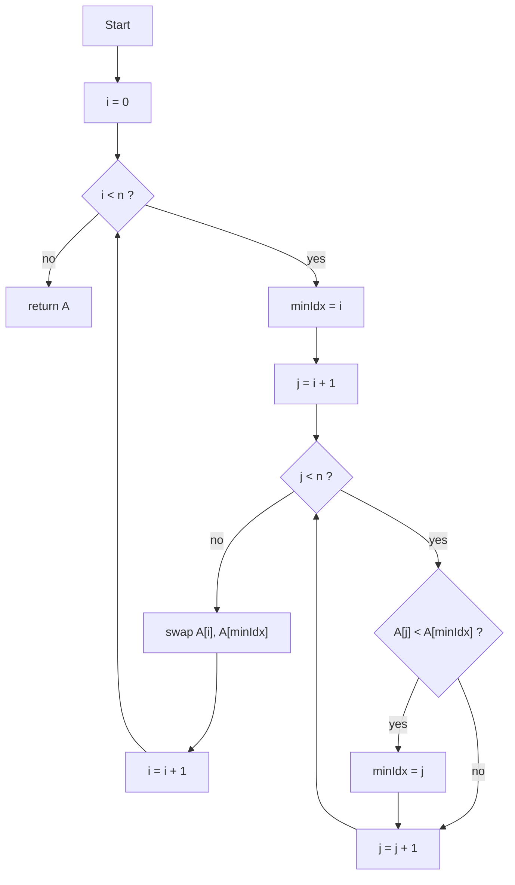

#### 4.3.3 Insertion

- Insertion sort builds a sorted prefix by shifting later showtimes to the
right and inserting each item into its correct position. 
- The current `insertion_time()` implementation converts the selected timestamps into
numeric time values using `Date.getTime()`.
- The algorithm is stable. Its best-case time complexity is **O(n)**, 
- while its average and worst-case time complexity is **O(n²)**.

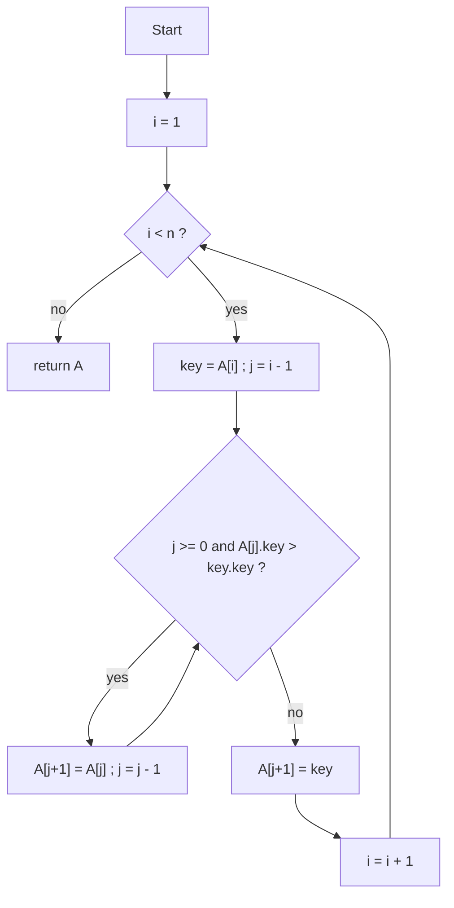

#### 4.3.4 Merge

The project uses recursive merge sort for name sorting.
- `merge_name()` :
    - divides the array into two halves 
    - recursively sorts each half 
    - and combines them using `mergeHalves()`.

if two names compare equally, the merge operation takes the item from the
left half first, preserving stability. The merged items are copied back
into the input array, so existing callers can continue using the same array.

The time complexity is **O(n log n)**, with **O(n)** auxiliary space and an **O(log n)** recursion depth.

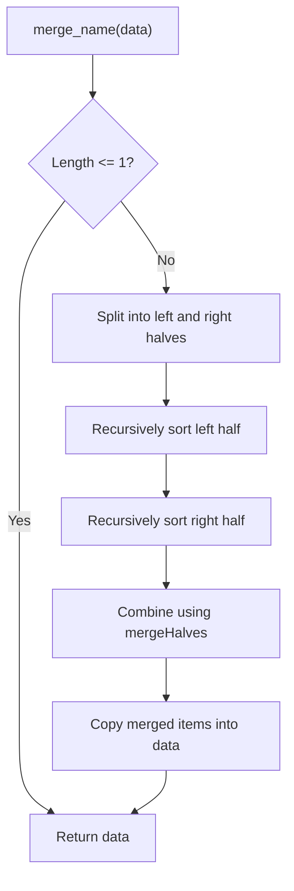

#### 4.3.5 Quick

we uses `quickSortInPlace()` for relevance ranking and for building the sorted search index.

- selects a median-of-three pivot and partitions each range into values </=/> than the pivot. 
- An explicit array-backed Stack stores the remaining ranges 
- so this implementation does not use recursive quicksort calls.
- Its average time complexity is **O(n log n)**
- while its worst-case time complexity is **O(n²)** 

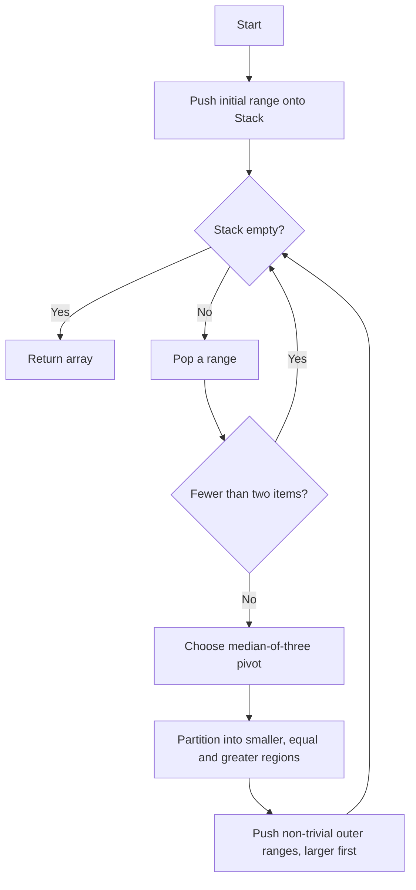

### 4.4 Pagination (windowed rendering)

`renderPage()` (`search.js:184-203`) implements fixed-size pagination — a classic array-windowing construct with boundary clamping:

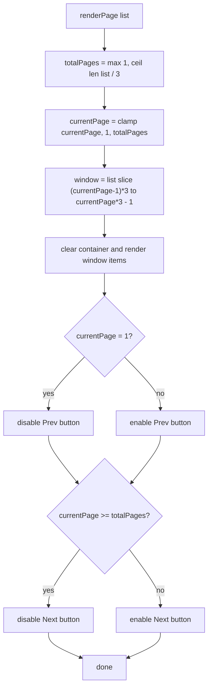

The left and right arrow keys trigger the same handlers by calling sub-functions(`search.js:248-256`), so the page is navigable by keyboard.

---

## 5 workflow: Dynamic Pricing and Ticket Arithmetic

### 5.1 User-selected showtime and price plan

- The search page displays the available showtimes and their associated
- price plans. 
- Selecting a showtime updates the current selection.
- Clicking the opera title 
- then stores the selected price ID and time in localStorage before opening the booking page.

The current payment endpoint does not persist the selected price ID or
showtime. Preserving this association in the completed order remains
an implementation improvement.

