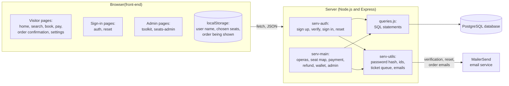
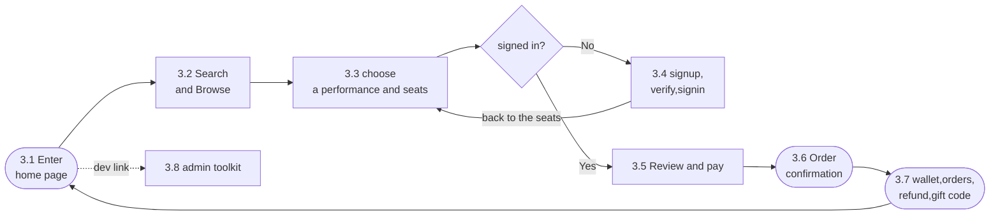
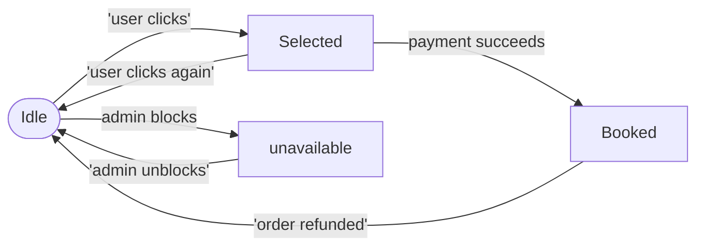
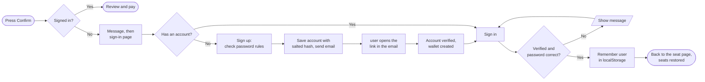
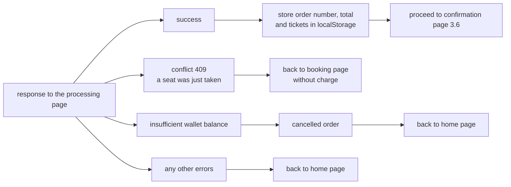
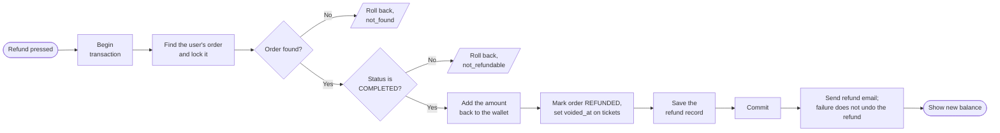

### **This is an explicit list for all the figures used in the essay of ict sba project, 2027 DSE**
#### Author: Clifford, Wu Jia An

##### 1.1

*Fig.1* system Architecture
Data stored in the database are fetched by back-end *Express* server but not directly by the front-end client-side browser.
- All queries were stored in `queries.js`;
- All emails were send by calling *Mailersend* api;
Note that an `exec` function in `child_process` is used in `serv.js` so when the server starts, the front-end page will show up in the user's default browser

##### 3.0

*Fig 2*   
user's journey. The arrow from 3.4 to 3.3 shows that after signing in , the user returns to the seat page with the chosen seats restored.

##### 3.3

*Fig.3* seat states.  
note that the admin cannot block a booked seat

##### 3.4

*Fig 4. Authentication path.*

##### 3.5

*Fig.5* Payment Flowchart  
every rejected branch ends before any money is taken.

*Fig.6* response to the processing page

##### 3.7

*Fig 7*. Refund flowchart. After the refund the seats are idle again (Fig.3).

---
