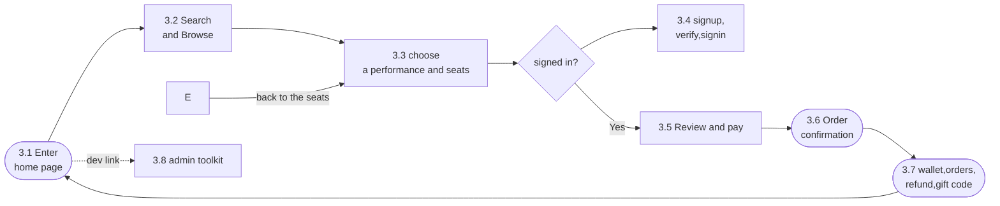
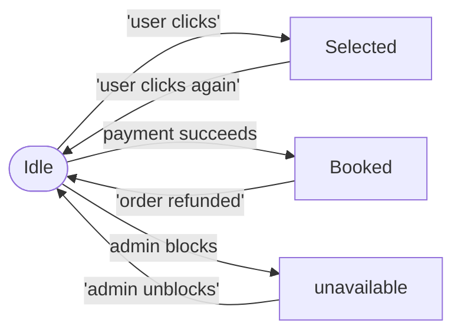
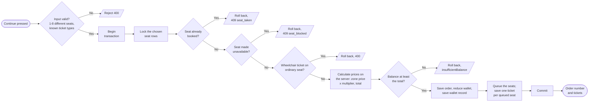
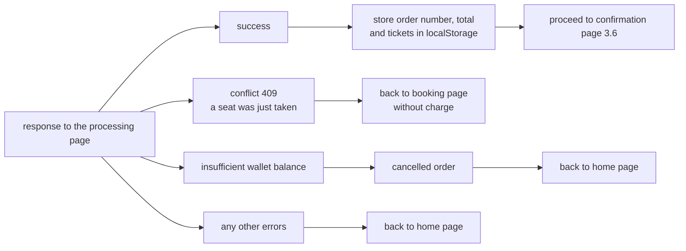

### 3.0

*Fig 2*   
user's journey. The arrow from 3.4 to 3.3 shows that after signing in , the user returns to the seat page with the chosen seats restored.

### 3.3

*Fig.3* seat states.  
note that the admin cannot block a booked seat

### 3.5

*Fig.5* Payment Flowchart  
every rejected branch ends before any money is taken.

*Fig.6* response to the processing page
